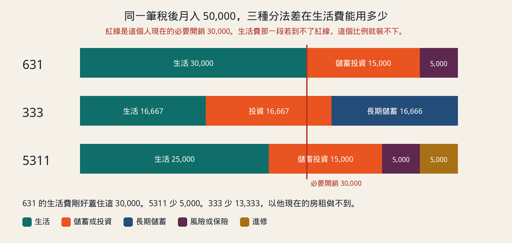
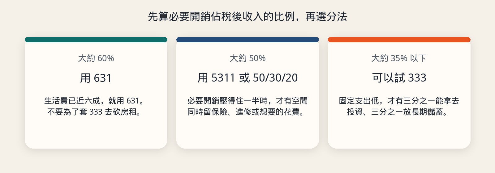
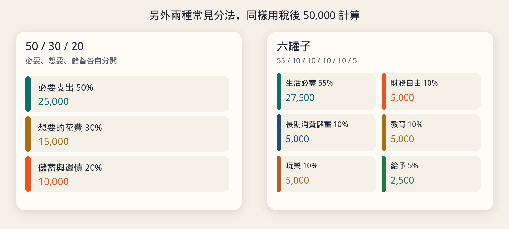

# 用同一筆薪水看懂 631、333、5311 和其他理財分法

這篇用稅後月入來比較幾種常見的薪水分配。631、333、5311 是台灣理財教學裡很常出現的三種比例。後面再補兩個國外也常用的分法：50/30/20，以及六罐子。

這些比例是預算習慣，不是投資建議，也沒有一種比例適用所有人。文章裡的報酬試算都標明是假設，不是預測，也不保證辦得到。

> **線上小工具：[薪水分配與投資試算](https://eddielincursor.github.io/research/budget/)**
> 填入月收入，選 631、333、5311 或 50/30/20，就會算出每一格的金額；投資那一格會接著帶進投資試算，用圖表看 10 年、20 年後大約會累積多少。直接用瀏覽器打開即可，資料不會上傳。

## 這些數字在分什麼

分的是**稅後、真正進帳戶的收入**，不是年薪，也不是已經存下來的資產。

三個方法都預設同一件事：發薪當天先把要留下的錢轉走，剩下的才拿來花。若是先花、月底有剩再存，剩下的通常是零。

同一個名稱，不同文章的格子定義會有一點差。這篇採用下面這組，也是目前教學裡最常見的分法：

| 方法 | 怎麼分 | 這篇採用的定義 |
| --- | --- | --- |
| 631 | 60 / 30 / 10 | 生活 60%，儲蓄與投資 30%，風險準備 10% |
| 333 | 各約三分之一 | 生活、投資、長期儲蓄各三分之一 |
| 5311 | 50 / 30 / 10 / 10 | 生活 50%，儲蓄投資 30%，保險 10%，自我成長 10% |

333 若寫成 33% 加三次，只有 99%。實務上用收入除以 3，尾數差 1 元放到其中一格。

有些文章把 631 的 30% 全部當成投資，10% 只放保險。也有人把 5311 的 30% 再拆成「儲蓄」和「投資」兩格。名稱相同時，先看對方每一格裝什麼，再套數字。

## 例子：稅後 50,000，必要開銷已經 30,000

假設一個人獨居，稅後月入 50,000 元。他現在每個月不能不付的帳是：

| 項目 | 金額 |
| --- | --- |
| 房租（含管理費） | 15,000 |
| 伙食 | 8,000 |
| 交通 | 2,500 |
| 手機、網路、水電 | 2,500 |
| 日用品與雜支 | 2,000 |
| 合計 | 30,000 |

30,000 除以 50,000 是 60%。房租一項就佔收入的 30%。

三種方法算出來的金額：

| 格子 | 631 | 333 | 5311 |
| --- | --- | --- | --- |
| 生活 | 30,000 | 16,667 | 25,000 |
| 儲蓄或投資 | 15,000 | 投資 16,667，另有長期儲蓄 16,666 | 15,000 |
| 風險、保險或進修 | 風險 5,000 | 沒有單獨一格，保障要從上面三格擠 | 保險 5,000，進修 5,000 |
| 加總 | 50,000 | 50,000 | 50,000 |

和他現在的 30,000 必要開銷比：

- **631** 的生活費剛好是 30,000，這個月不必先搬家就做得到。
- **5311** 的生活費只有 25,000，還差 5,000。他得從伙食、交通或換更便宜的房間補上這個缺口。
- **333** 的生活費只有 16,667，比現在少 13,333。房租 15,000 已經幾乎把整格用完，伙食沒有著落。以他現在的租約，333 做不到。

所以不是 333 比較「會理財」。是他的固定支出太高，硬套最緊的比例只會一個月就放棄。

## 什麼時候換方法

把必要開銷除以稅後收入：

- 接近或超過 **60%**：先用 631。同時看房租和固定扣款能不能降下來。
- 大約 **50%**：5311 或下面的 50/30/20 比較貼。
- 大約 **35% 或更低**：才有空間試 333。
- 超過 **70%**，或收入不穩：先不要談投資比例。先讓現金流不要每個月透支。

再看一個人，稅後 80,000，必要開銷 24,000，只佔 30%。

| 格子 | 631 | 333 | 5311 |
| --- | --- | --- | --- |
| 生活預算 | 48,000 | 26,667 | 40,000 |
| 和他實際的 24,000 比 | 預算多出 24,000 | 多出 2,667，裝得下 | 多出 16,000 |

這個人若繼續用 631，生活預算有 48,000，比實際需要多一倍，多出來的錢很容易花掉。他改用 333 才把「可以存下來」變成明確的兩格：投資約 26,667、長期儲蓄約 26,666。

比例是跟著開銷佔比走的，不是年資到了就要換成某個數字。

## 發薪日實際怎麼做

用第一個人的 631。三個帳戶分開：生活、儲蓄投資、風險準備。生活帳戶的金融卡不要連到另外兩個。

他目前沒有高利率的卡債，也還沒有緊急預備金。緊急預備金的目標先訂 **3 個月必要開銷**，也就是 30,000 乘以 3，等於 90,000。這筆錢放現金或活存，不拿去投資。投資帳戶的錢要能放數年不領；緊急預備金下個月可能就要付醫藥費或押金。

前幾個月，30% 和 10% 先一起把緊急預備金補滿。假設基本醫療與意外險的保費一個月 2,000，從風險準備那 5,000 裡付。

| 月 | 生活帳戶 | 轉入緊急預備金 | 預備金餘額 | 轉入投資 | 風險帳戶 |
| --- | --- | --- | --- | --- | --- |
| 1 | 30,000 | 20,000 | 20,000 | 0 | 這 20,000 先全部當緊急金 |
| 2 | 30,000 | 20,000 | 40,000 | 0 | 同上 |
| 3 | 30,000 | 20,000 | 60,000 | 0 | 同上 |
| 4 | 30,000 | 20,000 | 80,000 | 0 | 同上 |
| 5 | 30,000 | 10,000 | 90,000 | 10,000 | 20,000 拆成兩半 |
| 6 起 | 30,000 | 0 | 90,000 | 15,000 | 5,000。保費 2,000，剩下 3,000 留現金 |

第 5 個月的 20,000 分成兩半：10,000 把預備金補到 90,000，10,000 開始進投資帳戶。第 6 個月起才是穩定的 631：15,000 投資、5,000 風險、30,000 生活。

風險帳戶剩下的 3,000 不要為了「比例要用完」去買儲蓄型保單。保費夠用就讓它留成現金。進修預算也一樣，這個月沒有課，錢留在那一格，不回流到生活帳戶。

生活帳戶月底可以接近零。另外兩個帳戶不行拿去吃飯。不夠花時，先改下一期的伙食和娛樂，而不是把投資帳戶轉回來。若連續兩三個月都不夠，代表 60% 仍然偏低，要重算必要開銷，不是怪自己意志力。

## 另外兩種經典分法

### 50/30/20

這組來自 Elizabeth Warren 的消費預算：必要支出 50%、想要的花費 30%、儲蓄與還債 20%。

以 50,000 計算，是 25,000、15,000、10,000。

它和 5311 的差別在於：5311 把生活以外的錢拆成儲蓄投資、保險、進修；50/30/20 則把外食升級、娛樂、購物收進單獨的「想要」那 30%，儲蓄只有 20%。第一個人的必要開銷是 30,000，已經超過 25,000，所以 50/30/20 現在也裝不下，除非先省下 5,000。

想要和必要要先寫死。通勤是必要，週末旅行是想要。沒有這條線，30% 的想要會把 20% 的儲蓄吃掉。

### 六罐子

T. Harv Eker 在《有錢人想的和你不一樣》裡用六個帳戶：

| 罐子 | 比例 | 50,000 時的金額 | 規則 |
| --- | --- | --- | --- |
| 生活必需 | 55% | 27,500 | 房租、伙食、交通、基本保費 |
| 財務自由 | 10% | 5,000 | 只進不出，用來投資 |
| 長期消費儲蓄 | 10% | 5,000 | 旅行或大筆購物，存夠才花 |
| 教育 | 10% | 5,000 | 課程、書、能提高收入的技能 |
| 玩樂 | 10% | 5,000 | 這個月可以花掉，用來讓計畫持續得下去 |
| 給予 | 5% | 2,500 | 送禮或捐款 |

55% 加四個 10% 再加 5%，剛好 100%。第一個人的必要開銷 30,000，比生活必需罐的 27,500 多 2,500，還是差一點，但比 333 接近得多。

六罐子適合已經願意把錢拆很細的人。帳戶太多、卻沒有在發薪日自動轉帳，六格會變成六個沒在用的戶頭。

### 先存再花

這不是另一組比例，而是上面每一種方法都靠它才會發生。發薪日用銀行的預約轉帳，把儲蓄、投資、風險準備轉走。不要等月底。自動化比每個月重新決定一次可靠。

### 72 法則，以及每月投入的差別

72 法則用來心算一筆**放著不動**的錢何時變兩倍：72 除以假設的年化報酬率。假設年化 6%，72 除以 6 等於 12，大約 12 年變兩倍。這是近似，而且只適用於一整筆、中途不加減的錢。

每月固定轉入是另一種算法。下面假設緊急預備金已經存滿，之後每個月底投入 15,000，假設年化 6%、按月複利，中途不領，也不計手續費和稅。6% 是為了算給你看，不是市場會給的報酬。

| 期間 | 自己投入的本金 | 假設 6% 時的結存 | 其中假設賺到的部分 |
| --- | --- | --- | --- |
| 5 年 | 900,000 | 約 1,046,550 | 約 146,550 |
| 10 年 | 1,800,000 | 約 2,458,190 | 約 658,190 |
| 20 年 | 3,600,000 | 約 6,930,613 | 約 3,330,613 |

就算假設成立，前 5 年大部分仍是自己存進去的本金。比例先決定「每個月有沒有 15,000 進得去」，報酬率是之後的事。報酬率用 6% 只是例子，改成 3% 或 8%，結存會差很多，所以這張表不能拿來比較商品。

## 比例沒有處理的事

- **高利率負債先於投資。** 卡債或信用貸款的利率若遠高於合理的投資報酬，多出來的錢先拿去還債。上面的例子假設沒有這種負債。
- **緊急預備金不要拿去投資。** 股票或基金可能在你失業的那個月下跌。現金預備金和投資帳戶分開。
- **保險買保障，不拿來湊比例。** 10% 的風險準備是要看醫療、意外、失能這類保障夠不夠，不是每個月必須花完。
- **收入不固定時，用過去半年較低的月收入來分。** 用最好的那個月當分母，淡季會立刻破功。
- **兩個人一起生活，先合併必要開銷再分。** 各自用自己的薪水套 631，房租卻只由一個人付，比例會失真。

## 這篇怎麼用

1. 寫下稅後月入。
2. 列出三個月內幾乎不能砍的開銷，算出佔比。
3. 佔比接近 60% 用 631，接近 50% 用 5311 或 50/30/20，35% 以下再考慮 333。
4. 發薪日自動轉帳。緊急預備金未滿 3 個月必要開銷之前，投資那一格先暫停。
5. 連續三個月生活帳戶都不夠，就重算比例，不從投資帳戶倒扣。

步驟 1 到 3 可以直接用[薪水分配與投資試算](https://eddielincursor.github.io/research/budget/)算，網址會記住你填的數字，存成書籤下個月再打開就好。
