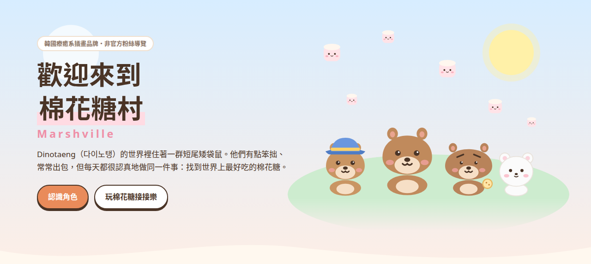
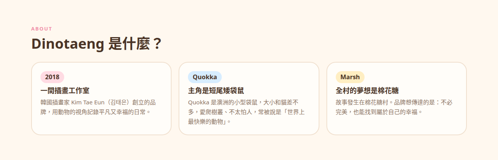
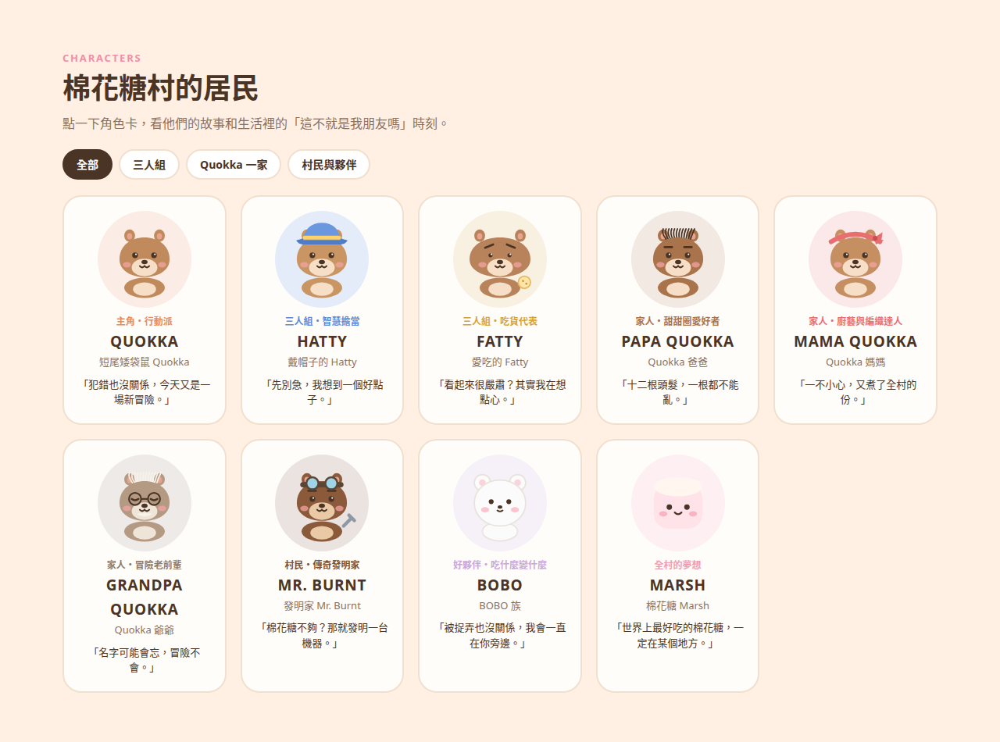
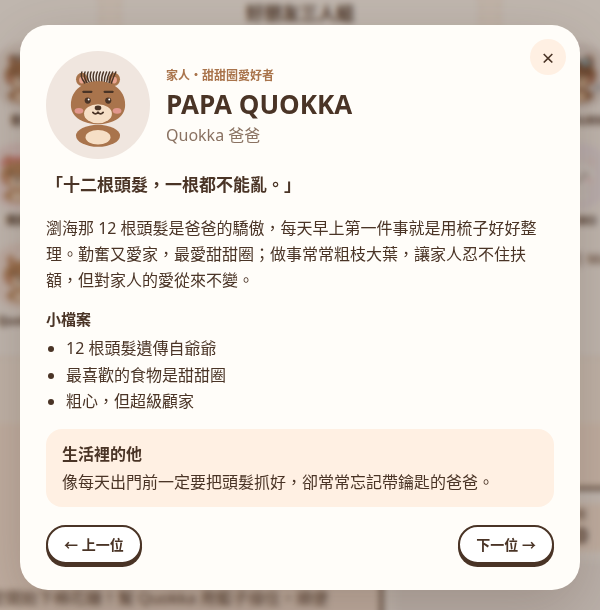
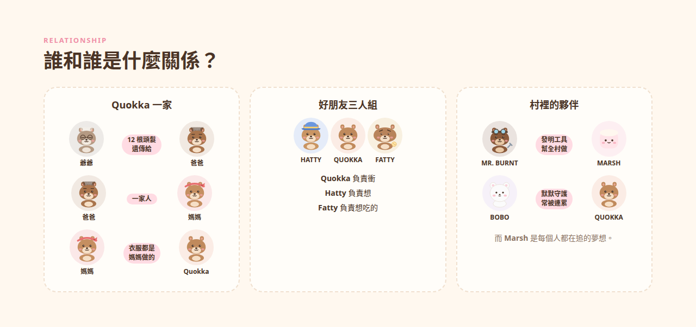
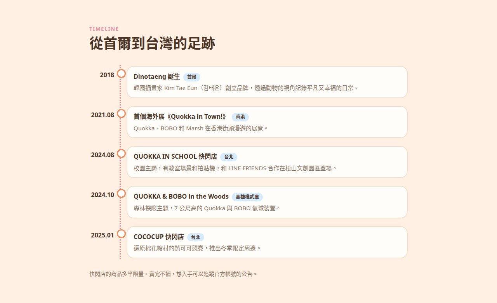
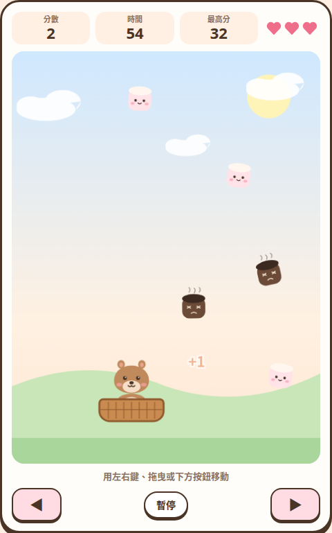
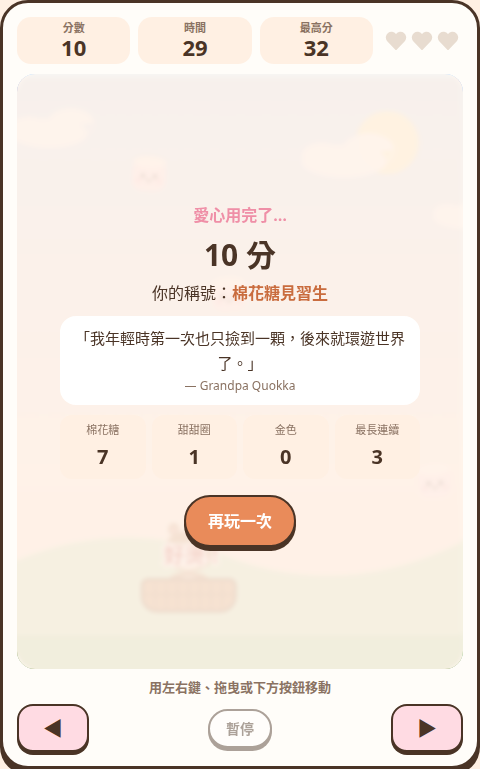
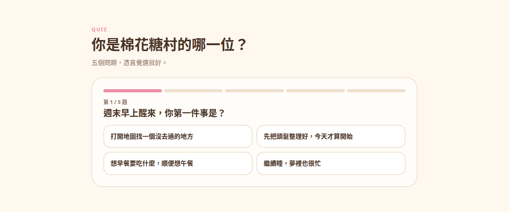

# 歡迎來到棉花糖村：Dinotaeng 角色介紹與療癒心得

最近在文具店、手搖飲聯名杯、手機殼上，常常看到一隻咧嘴笑的棕色小袋鼠，旁邊跟著一隻白白圓圓的小傢伙。牠們來自韓國插畫品牌 **Dinotaeng（다이노탱）**，故事發生在一個叫 **棉花糖村（Marshville）** 的地方。

這篇整理 Dinotaeng 的品牌故事、九位主要角色，以及為什麼一群「常常出包」的角色，能讓那麼多上班族和學生覺得被療癒。

> **線上小網站：[歡迎來到棉花糖村](https://eddielincursor.github.io/research/dinotaeng/)**
> 可愛風的角色導覽，還有「棉花糖接接樂」小遊戲和「你是棉花糖村的哪一位？」測驗，手機也能玩。

*本文與網站中的角色插圖，都是依角色特徵自行繪製的簡化示意，不是官方造型。官方角色圖請看 [Dinotaeng 官方網站](https://en.dinotaeng.com/) 與 [Instagram @dinotaeng](https://www.instagram.com/dinotaeng/)。*

## Dinotaeng 是什麼

Dinotaeng 是韓國插畫家 **Kim Tae Eun（김태은）** 在 2018 年創立的插畫工作室與文創品牌。品牌的初衷，是用動物的視角記錄平凡又幸福的日常，提醒忙碌的人停下腳步，好好放鬆、好好生活。

故事舞台棉花糖村的居民，大多是以澳洲短尾矮袋鼠為原型的 Quokka 一家。村裡每個人都有點笨拙，卻都活力滿滿。全村有一個共同的人生目標：**找到世界上最好吃的棉花糖。**

品牌想傳達的理念可以濃縮成一句話：**不必完美，也能找到幸福。**

### Quokka 是什麼動物？

Quokka 的中文是**短尾矮袋鼠**，是澳洲西南部特有的小型有袋動物，最有名的棲地是西澳外海的羅特尼斯島（Rottnest Island）。牠們大小和家貓差不多，擅長在灌木叢裡跳來跳去，嘴角天生微微上揚，所以常被稱為「世界上最快樂的動物」。

Dinotaeng 抓住了這個「看起來永遠在笑」的特點：角色們再怎麼出包，臉上還是那個笑容。

> 小知識：真實的短尾矮袋鼠是受保護動物，在澳洲餵食或觸摸牠們都可能被罰款。喜歡牠們，用相機和插畫就好。

## 九位角色介紹

棉花糖村的角色大致分成三群：**好朋友三人組**、**Quokka 一家**，以及**村裡的夥伴**。

### 1. QUOKKA｜主角・行動派

棉花糖村所有故事的起點。樂觀外向，什麼新鮮事都想試，村裡大大小小的活動都少不了他。喜歡惡作劇、常常犯錯，但對 Quokka 來說，每一次經歷都是有意義的人生片段。

**生活裡的 Quokka**：那個說走就走、這個月報名陶藝課、下個月跑去學衝浪的朋友。學得不怎麼樣，但每次都笑得最開心。

### 2. HATTY｜三人組的智慧擔當

Quokka 和 Fatty 的好朋友，頭腦聰明，遇到問題能冷靜分析、想出好點子。他有個小秘密：**帽子從來不脫**，大家都很好奇帽子底下到底藏了什麼。

**生活裡的 Hatty**：旅行時默默查好交通、還多帶一顆行動電源的朋友。問他為什麼總戴同一頂帽子，他只會神秘一笑。

### 3. FATTY｜三人組的吃貨代表

一對短短的眉毛，讓他看起來總是一臉嚴肅、帶點委屈。其實他的小腦袋裡，滿滿都是被零食包圍、怎麼吃都吃不完的幻想。只要有吃的，眼睛馬上發亮。

**生活裡的 Fatty**：開會時面無表情、看起來在深思，其實在想中午吃排骨飯還是牛肉麵的同事。

### 4. PAPA QUOKKA｜十二根頭髮的爸爸

瀏海上的 **12 根頭髮**是爸爸的驕傲，每天早上第一件事就是拿梳子好好整理。勤奮又愛家，最愛甜甜圈；做事常常粗枝大葉，讓家人忍不住扶額，但對家人的愛從來沒變過。

**生活裡的 Papa**：出門前一定要把頭髮抓好，卻常常忘記帶鑰匙、回頭按電鈴的爸爸。

### 5. MAMA QUOKKA｜廚藝與編織達人

溫柔親切，用好吃的料理把幸福帶給大家。一開始下廚就停不下來，常常不小心煮出整個村子都吃得飽的份量。編織手藝也很厲害，全家人的衣服都是她一針一線做出來的。

**生活裡的 Mama**：過年說「隨便煮幾道就好」，結果端出十二道菜，最後還幫你打包三個保鮮盒帶走的媽媽。

### 6. GRANDPA QUOKKA｜冒險老前輩

年輕時四處旅行探險，累積了滿滿的智慧和經驗，村裡遇到難題，他常能靈光一閃想出辦法。年紀大了，偶爾會忘記自己叫什麼名字，但冒險回憶都還記得清清楚楚。爸爸那 12 根頭髮，就是遺傳自爺爺。

**生活裡的 Grandpa**：記不得你上週說過什麼，卻能把四十年前騎車環島的每一站講得活靈活現的長輩。

### 7. MR. BURNT｜傳奇發明家

棉花糖村手藝最好的發明家，專門製作各種做棉花糖、研究棉花糖的工具。據說他發明過蒸汽引擎，讓村子可以大量生產蓬鬆香甜的棉花糖，是村裡的傳奇人物。

**生活裡的 Mr. Burnt**：嫌流程太慢，週末就寫了一支小程式，幫全組每週省下半天的同事。

### 8. BOBO｜吃什麼就變什麼的好夥伴

棉花糖村住著各式各樣的 BOBO，常和 Quokka 一家玩在一起。他們安靜可愛，常因為 Quokka 家族的粗心或調皮而倒楣，卻從不抱怨，一直忠心守在朋友身邊。

BOBO 最有趣的設定是：**吃下什麼，外表就可能跟著變。**據說有一隻 BOBO 吃了 Papa 用過的燈泡，就變成會發光的燈泡 BOBO。官方商品也出過可頌 BOBO、Oreo BOBO 等造型。

**生活裡的 BOBO**：被你拖去排隊三小時，還幫你顧包包、拍照的好朋友。

### 9. MARSH｜全村的夢想

Marsh 就是棉花糖。村子的名字 Marshville 由此而來，全村的共同目標，是找到世界上最大、最好吃的夢幻棉花糖。為了這個夢想，大家世世代代都在研究：要怎麼種，才能種出完美的棉花糖？

**生活裡的 Marsh**：每個人心裡那份「總有一天要做到」的小夢想。不急，但一直都在。

## 誰和誰是什麼關係

- **Quokka 一家**：爺爺把 12 根頭髮遺傳給爸爸；媽媽幫全家做衣服；Quokka 是全家最愛闖禍的那一個。
- **好朋友三人組**：Quokka 負責衝，Hatty 負責想，Fatty 負責想吃的。三個人剛好互補。
- **村裡的夥伴**：Mr. Burnt 幫全村發明棉花糖工具；BOBO 默默守護 Quokka 一家，也常常被連累；Marsh 則是每個人都在追的夢想。

## 為什麼一群「常出包」的角色這麼療癒

### 一、不完美被當成日常，而不是失敗

Quokka 常犯錯，Papa 常忘東忘西，Grandpa 會忘記自己的名字，但故事從來不把這些當成要被糾正的缺點。

想像你剛在簡報上講錯數字，回家滑到 Quokka 又把事情搞砸、還笑得很開心的圖。那一刻你會覺得：好像也沒那麼嚴重。

### 二、每個角色都有一個小小的堅持

Papa 的 12 根頭髮、Hatty 不脫的帽子、Fatty 對零食的執著。這些堅持在旁人看來很小，對角色來說卻很重要。

這很像我們生活裡的小儀式：早上一定要喝的那杯咖啡、睡前一定要追的那集劇。它們不會改變世界，卻讓一天變得像自己的。

### 三、身邊總有人陪

BOBO 被捉弄也不離開，Mama 的料理永遠多一份。棉花糖村裡沒有誰是一個人過日子的。對獨自在外地工作、讀書的人來說，這種「有人一起」的畫面特別有吸引力。

### 四、目標很遠，但每天都很快樂

「找到世界上最好吃的棉花糖」是一個可能永遠達不到的目標，但村民沒有因此焦慮，而是把尋找的過程過得很開心。比起「達成了沒」，他們更在意「今天有沒有好好玩」。

## 從首爾到台灣的足跡

| 時間 | 活動 | 地點 |
| --- | --- | --- |
| 2018 | Dinotaeng 創立 | 首爾 |
| 2021 年 8 月 | 首個海外展覽《Quokka in Town!》 | 香港 |
| 2024 年 8 月 | 「QUOKKA IN SCHOOL」校園主題快閃店，與 LINE FRIENDS 合作 | 台北松山文創園區 |
| 2024 年 10–11 月 | 「QUOKKA & BOBO in the Woods」森林主題快閃店，有 7 公尺高的氣球裝置 | 高雄棧貳庫 |
| 2025 年 1–2 月 | 「COCOCUP」熱可可主題快閃店 | 台北松山文創園區 |

在台灣比較常見的聯名，包括五桐號的飲料杯與周邊、CASETiFY 手機殼、樂事洋芋片禮盒、SPAO 睡衣、上友（SUNFRIEND）糖果禮盒，以及 Maltesers 麥提莎巧克力組合。

### 入坑小提醒

- **追官方帳號**：快閃店與新品多半先在官方 Instagram 公告。
- **限量常常賣完不補**：想要的款式，開賣當週就要決定。
- **留意仿冒品**：價格明顯偏低、沒有官方吊牌或授權標示的商品，要多留意。
- **量力而行**：療癒是看到角色會笑，不是看到帳單會哭。可以先想好這一季的預算，再去逛。

## 線上小網站：歡迎來到棉花糖村

我把這篇的內容做成一個可愛風的小網站：

**<https://eddielincursor.github.io/research/dinotaeng/>**

網站裡有：

1. **角色卡**：點一下就會跳出角色故事、小檔案和「生活裡的他」。可以篩選三人組、Quokka 一家、村民與夥伴。
2. **角色關係圖**：一眼看懂誰和誰是什麼關係。
3. **棉花糖接接樂**：60 秒小遊戲，下面會說明玩法。
4. **你是棉花糖村的哪一位？**：五題小測驗。
5. **時間軸**：Dinotaeng 從首爾到台灣的展覽與快閃店。

### 棉花糖接接樂怎麼玩

Mr. Burnt 的棉花糖機失控了，天空開始下棉花糖。你要幫 Quokka 用籃子接住它們：

| 掉下來的東西 | 效果 |
| --- | --- |
| 棉花糖 | +1 分 |
| 爸爸最愛的甜甜圈 | +3 分 |
| 金色棉花糖 | +5 分，掉得比較快 |
| BOBO | 陪你 6 秒，這段時間分數 ×2 |
| 烤焦的棉花糖 | 扣一顆愛心，三顆用完就結束 |

連續接住、不漏接，倍率最高會到 ×3。電腦用方向鍵或 A、D 移動，手機直接在畫面上左右拖曳，或按下方的箭頭。遊戲結束後，會依分數拿到一個稱號，從「棉花糖見習生」到「傳說中的棉花糖王」。

  
  

### 你是棉花糖村的哪一位？

五個問題，像是「週末早上醒來，你第一件事是？」「朋友出包了，你會？」。照直覺選，最後會告訴你最像哪個角色，並附上那位角色的生活例子。

## 最後

棉花糖村沒有反派，也沒有非贏不可的比賽，只有一群一直出包、卻一直很開心的居民。累的時候，看一下 Quokka 的笑臉；想放棄某個小夢想的時候，想想全村那顆還沒找到的棉花糖。

**不必完美，也能找到幸福。**這大概就是 Dinotaeng 最想說的話。

## 資料來源

- [DINOTAENG 官方網站（英文）](https://en.dinotaeng.com/)
- Pinkoi 設計誌，[超人氣韓國 Dinotaeng 角色介紹，可愛短尾矮袋鼠家族療癒你的每一天！](https://blog.pinkoi.com/tw/hot-topics/2412-dinotaeng-characters/)
- PopDaily 波波黛莉，[你叫得出他們的名字嗎？超萌短尾矮袋鼠 DINOTAENG 9 個角色介紹](https://www.popdaily.com.tw/life/1556206)
- 女孩趣（girlstalk），[短尾矮袋鼠到底在紅什麼？韓國最療癒袋鼠 Dinotaeng 完整介紹](https://www.girlstalk.cc/article/79975)
- 角色名稱、設定與官方插圖版權屬於 DINOTAENG。本文是非官方的粉絲整理。
