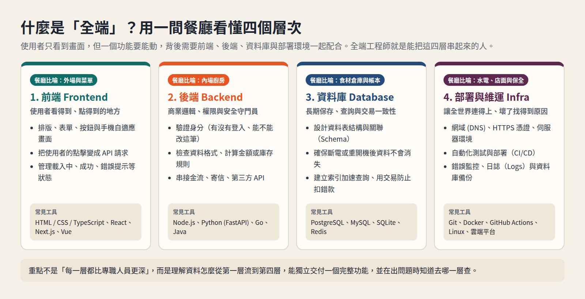
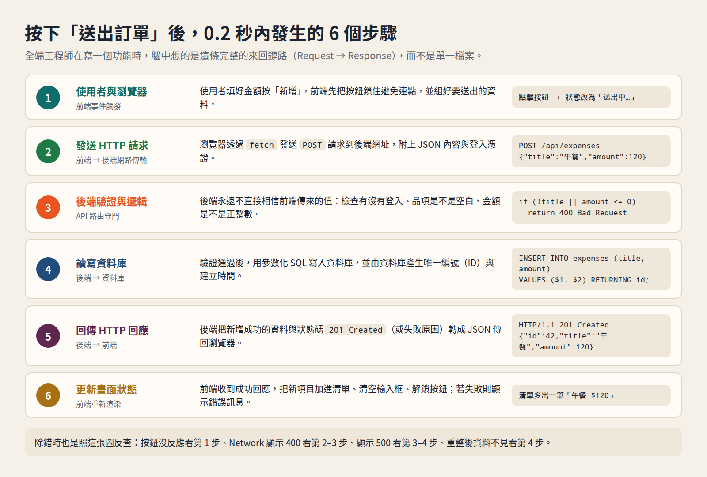
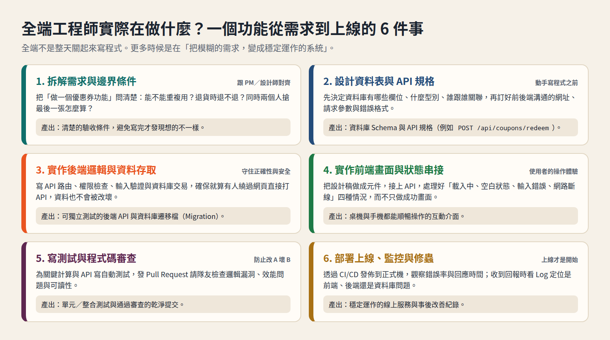
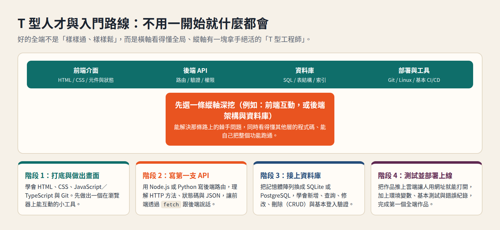

# 全端是什麼？全端工程師在做什麼？從餐廳比喻到親手看懂一條完整功能

剛開始學寫程式時，最常聽到的三個職務名稱是**前端（Frontend）**、**後端（Backend）**與**全端（Full-Stack）**。很多人聽完定義還是覺得抽象：為什麼做一個網站要分這麼多端？全端工程師是不是要一個人打十個？平常上班到底在忙什麼？

這篇用生活比喻、真實工作流程與一段精簡的「記帳功能」程式碼，帶你一次看懂：

1. **全端是什麼**：前端、後端、資料庫、部署環境各自負責什麼。
2. **按下按鈕後的 0.2 秒**：一筆資料怎麼走完一整圈。
3. **全端工程師的日常**：一個功能從一句需求到正式上線，中間要做哪六件事。
4. **程式碼實戰**：看同一個功能在資料庫、後端 API 與前端畫面長什麼樣子。
5. **怎麼入門**：什麼是「T 型工程師」，以及不會卡住的四階段學習路線。

---

## 一、什麼是「全端」？先用一間餐廳看懂四個層次

想像你走進一間餐廳點一碗牛肉麵。你看到的是裝潢、菜單、點餐機；但要讓你吃到那碗麵，後面還要有廚房、食材倉庫，以及整間店的水電與店面。

一個網路服務（網站、App、內部系統）也是由這四層疊起來的，「Stack（技術堆疊）」指的就是這四層的組合，而**全端（Full-Stack）**就是能橫跨這四層、把一個功能從頭到尾串起來：



| 層次 | 餐廳比喻 | 在軟體裡負責什麼 | 如果少了這一層會怎樣 |
| --- | --- | --- | --- |
| **1. 前端（Frontend）** | 外場裝潢、菜單、點餐機 | 使用者在瀏覽器或手機上看得到、點得到的畫面，以及按下按鈕後的互動狀態 | 有功能卻沒有人會用，或畫面卡住、在手機上破版 |
| **2. 後端（Backend）** | 內場廚房 | 驗證身分、檢查規則、計算金額、決定誰能看或改哪些資料、串接金流或寄信 | 任何人都能亂改別人的資料、把商品價格改成 0 元 |
| **3. 資料庫（Database）** | 食材倉庫與帳本 | 把會員、訂單、文章安全地存起來，確保重開機也不會消失，並能快速搜尋 | 伺服器一重啟，所有人的帳號和訂單全部清空 |
| **4. 部署與維運（Infra / DevOps）** | 店面、水電、收銀保全 | 網域、HTTPS 加密、雲端伺服器、自動測試與部署（CI/CD）、錯誤監控與備份 | 只有你自己的電腦打得開（`localhost`），別人連不上 |

### 為什麼不能全部寫在前端就好？

初學者最常問：「既然瀏覽器已經能跑 JavaScript，為什麼還要分前端和後端？」

因為**前端跑在使用者的電腦或手機裡，所有程式碼跟變數都是攤在陽光下的**。任何人只要按 `F12` 打開瀏覽器開發者工具，就能修改前端的判斷邏輯。

- **可以放前端的事**：字體大小、動畫、切換分頁、在送出前先提醒「金額不能空白」（為了體貼使用者，讓他不用等網路來回）。
- **一定要放後端的事**：檢查密碼對不對、確認帳戶餘額夠不夠、判斷這張優惠券過期了沒、讀寫資料庫（為了安全與正確性）。

前面我們在理財篇做的[薪水分配與投資試算](https://eddielincursor.github.io/research/budget/)就是一個**純前端**工具：它不存任何人的私人帳密，所以只用瀏覽器就能算完；但只要你想加上「登入帳號、把每個月的記帳存起來、換手機打開還看得到」，就立刻需要後端與資料庫，變成一個**全端應用**。

---

## 二、按下按鈕的 0.2 秒內，全端世界發生了什麼事？

全端工程師在寫程式時，腦中想的不是「我要寫一個檔案」，而是**一條完整的資料流（Request → Response）**。

假設你在做一個記帳網站，使用者填了「午餐 120 元」並按下「新增」，這 0.2 秒內其實跑完了 6 個步驟：



1. **前端觸發事件**：瀏覽器攔截表單送出，先把按鈕鎖成「送出中…」防止使用者連點兩次，並把「午餐、120」打包。
2. **發送 HTTP 請求**：前端透過 `fetch` 向後端網址 `POST /api/expenses` 發出請求，內容是 JSON 格式。
3. **後端守門與驗證**：後端收到請求，先確認「這個人有登入嗎？」再檢查「品項有沒有填？金額是不是大於 0 的整數？」如果不合法，直接回傳 `400 Bad Request` 擋掉。
4. **寫入資料庫**：驗證通過後，後端執行 SQL 把資料寫進 `expenses` 資料表，資料庫自動產生編號 `id = 42` 與時間戳記。
5. **回傳 HTTP 回應**：後端把剛存好的那筆完整資料（含 `id: 42`）連同狀態碼 `201 Created` 傳回給瀏覽器。
6. **前端更新畫面**：瀏覽器收到 `201`，把「午餐 $120」加進畫面清單、清空輸入框、解鎖按鈕。

### 這張圖也是全端工程師的「除錯地圖」

當有人回報「新增按鈕壞掉了！」，全端工程師不會瞎猜，而是順著這 6 步縮小範圍：

- 按了完全沒送出請求？→ 看**步驟 1**（前端事件有沒有綁對、是不是表單驗證擋住了）。
- 瀏覽器 Network 面板看到紅字 `400` 或 `422`？→ 看**步驟 2 與 3**（前端傳錯欄位名稱，或後端驗證規則太嚴）。
- 看到紅字 `500 Internal Server Error`？→ 看**步驟 3 與 4**（後端程式寫錯、資料庫沒連上、SQL 語法錯誤）。
- 回傳成功，但重新整理網頁後資料不見？→ 看**步驟 4**（根本沒寫進資料庫，或寫錯張表）。
- 重新整理才看得到，剛按完畫面沒變？→ 看**步驟 6**（前端拿到回應後忘了更新畫面狀態）。

---

## 三、全端工程師每天的工作是什麼？

很多人以為全端工程師的一天就是「早上切版、下午寫 SQL」。實際上，寫程式大約只佔一半時間；另一半時間在做**翻譯與設計**——把人類講的話（產品需求），翻譯成機器不會出錯的規則（資料結構與程式邏輯）。

以「做一個新增記帳功能」或「做一個優惠券折抵功能」為例，從接到任務到上線，全端工程師會走過這 6 件事：



### 1. 拆解需求與邊界條件（跟 PM、設計師對齊）

需求通常只有一句話：「讓使用者可以輸入優惠碼打折。」但工程師腦中會立刻冒出十個問題：

- 優惠碼分不分大小寫？前後多打空白要不要自動去掉？
- 同一張優惠券一個人能用幾次？總共限量幾張？
- 如果只剩最後 1 張，兩個人在同 0.01 秒按下結帳，怎麼避免超賣？
- 訂單取消或退貨時，優惠券要退回給使用者嗎？

在寫第一行程式碼之前把這些問清楚，能省下後面好幾天的重工。

### 2. 設計資料表（Schema）與 API 合約

動手寫畫面之前，通常會**先設計資料長什麼樣子**。只要資料結構想清楚了，後面的程式碼往往順水推舟；資料結構想錯，畫面寫得再漂亮都要打掉重練。

同時也會訂好前後端怎麼溝通（稱為 API 規格或合約）：網址叫什麼、要傳哪些欄位、成功回什麼、失敗回什麼。如果是全端自己一個人做，這份規格能幫自己理清腦袋；如果是跟其他前／後端同事合作，定好合約後兩邊就能同時開工。

### 3. 實作後端邏輯與資料庫存取

把資料表建起來，寫好 API 路由、身分驗證、輸入檢查與資料庫讀寫。全端工程師在寫這一段時，心裡想的是**「假設前端壞了，或有人用程式直接打我這支 API，我的資料庫會不會被弄髒？」**

### 4. 實作前端畫面與狀態串接

切出畫面元件、綁定表單，並接上剛剛寫好的 API。有經驗的全端工程師不會只寫「成功畫面（Happy Path）」，而會固定檢查四種狀態：

- **空白狀態（Empty State）**：一筆資料都沒有時，畫面要引導使用者新增，而不是一片白。
- **載入狀態（Loading State）**：網路慢的時候要有轉圈或骨架畫面，按鈕要防連點。
- **錯誤狀態（Error State）**：後端回傳失敗或斷網時，要用人類看得懂的話告訴使用者怎麼辦。
- **成功狀態（Success State）**：資料更新、表單歸零、給予清楚回饋。

### 5. 寫自動化測試與程式碼審查（Code Review）

改一行程式很容易，難的是「三個月後別人改了另一支檔案，怎麼確定沒有把你今天寫的功能弄壞？」所以全端工程師會針對關鍵邏輯與 API 寫自動化測試，並透過 Git 發出 Pull Request，和隊友互相審查程式碼的安全性、效能與可讀性。

### 6. 部署上線、監控與修蟲

透過自動化流程（例如 GitHub Actions）跑完測試並部署到雲端。上線後觀察系統日誌（Logs）與錯誤警報，確保真實使用者湧進來時，資料庫查詢不會變慢、伺服器不會當機。

---

## 四、程式碼實戰：用 60 行看懂一個功能的「全端三明治」

光講概念不夠直覺。下面我們用最常見的現代全端組合（**SQL 資料庫 + TypeScript 後端 API + React 前端元件**），把前面圖裡的「新增一筆記帳」真的寫出來。

讀的時候不用背語法，請觀察**同一筆資料（`title` 跟 `amount`）怎麼流過這三層**。

### 第 1 層：資料庫（Database Schema）

先在資料庫建一張 `expenses` 表，規定每一筆記帳一定要有編號、名稱、大於 0 的金額與建立時間：

```sql
CREATE TABLE expenses (
  id          SERIAL PRIMARY KEY,
  title      TEXT NOT NULL,
  amount     INTEGER NOT NULL CHECK (amount > 0),
  created_at TIMESTAMPTZ NOT NULL DEFAULT NOW()
);
```

注意那個 `CHECK (amount > 0)`：這是最後一道防線，連資料庫本身都拒絕存入負數或 0 元的金額。

### 第 2 層：後端 API（Backend Route Handler）

接著寫一支後端路由處理 `POST /api/expenses`。它的工作只有三件：**檢查輸入 → 寫入資料庫 → 回傳結果**：

```typescript
// POST /api/expenses
export async function POST(request: Request) {
  const body = await request.json();
  const title = String(body.title ?? "").trim();
  const amount = Number(body.amount);

  // 1. 後端驗證：永遠不要直接相信前端傳來的值
  if (!title || !Number.isInteger(amount) || amount <= 0) {
    return Response.json(
      { error: "請輸入品項名稱，且金額必須為正整數" },
      { status: 400 },
    );
  }

  // 2. 參數化查詢寫入資料庫（用 $1, $2 防止 SQL Injection 攻擊）
  const row = await db.queryOne(
    `INSERT INTO expenses (title, amount)
     VALUES ($1, $2)
     RETURNING id, title, amount, created_at`,
    [title, amount],
  );

  // 3. 回傳 201 Created 與新建立的資料
  return Response.json(row, { status: 201 });
}
```

### 第 3 層：前端畫面（Frontend Component）

最後是使用者看到的表單。它負責收集輸入、管理「送出中／錯誤訊息」狀態，並在成功後更新畫面上的清單：

```tsx
export function ExpenseForm({ onAdded }: { onAdded: (item: Expense) => void }) {
  const [title, setTitle] = useState("");
  const [amount, setAmount] = useState("");
  const [loading, setLoading] = useState(false);
  const [error, setError] = useState<string | null>(null);

  async function handleSubmit(e: React.FormEvent) {
    e.preventDefault();
    setLoading(true);
    setError(null);

    try {
      const res = await fetch("/api/expenses", {
        method: "POST",
        headers: { "Content-Type": "application/json" },
        body: JSON.stringify({ title, amount: Number(amount) }),
      });
      const data = await res.json();

      if (!res.ok) {
        setError(data.error ?? "新增失敗，請稍後再試");
        return;
      }

      onAdded(data);      // 把後端回傳的新資料加進畫面清單
      setTitle("");       // 清空輸入框
      setAmount("");
    } finally {
      setLoading(false);  // 無論成功失敗都解鎖按鈕
    }
  }

  return (
    <form onSubmit={handleSubmit}>
      <input value={title} onChange={(e) => setTitle(e.target.value)} placeholder="品項（例：午餐）" />
      <input value={amount} onChange={(e) => setAmount(e.target.value)} placeholder="金額" inputMode="numeric" />
      <button type="submit" disabled={loading}>
        {loading ? "送出中…" : "新增記帳"}
      </button>
      {error && <p role="alert">{error}</p>}
    </form>
  );
}
```

把這三段放在一起看，你就會明白為什麼很多團隊喜歡全端工程師：**因為這三段程式碼本來就是在講同一件事。** 當同一個人能看懂這三層，就不會發生「前端等後端改一個欄位等三天」或「後端開出來的資料格式，前端根本沒辦法畫成畫面」的斷層。

---

## 五、全端 vs. 純前端 vs. 純後端：不同公司怎麼分工？

既然全端這麼方便，為什麼大公司還是要分前端工程師、後端工程師、SRE（網站可靠性工程師）？

因為**當系統規模變大，每一層的深度都會爆炸**：

| 比較項目 | 純前端工程師 | 純後端工程師 | 全端工程師 |
| --- | --- | --- | --- |
| **核心戰場** | 複雜互動、動畫流暢度、跨裝置相容、前端效能與設計系統 | 高併發流量、微服務架構、資料一致性、資安與佇列處理 | **端到端交付功能**、系統整合、快速驗證產品想法 |
| **常在哪裡看到** | 重視體驗的產品、大型電商、複雜後台、設計系統團隊 | 金流、高流量平台、大型企業核心系統、資料工程 | 新創公司、中小型產品團隊、大型企業的新產品／內部工具組 |
| **最大優勢** | 把使用者體驗與介面細節做到極致 | 系統承受十萬人同時在線也不會垮、帳不會算錯 | 溝通成本極低，一個人就能把一個功能從 0 做到上線 |
| **常見瓶頸** | 遇到需要改資料庫或 API 設計時，必須等後端排程 | 做好了強大的引擎，卻沒有人幫他做出好用的操作介面 | 什麼都要碰，如果沒有刻意深耕某一塊，容易變成「樣樣通、樣樣鬆」 |

所以這三種角色不是「誰比誰高級」，而是**切分問題的方式不同**：

- **按層次切（Horizontal slicing）**：一個人管前端、一個人管後端、一個人管資料庫。適合規模很大、每一層都很深的系統。
- **按功能切（Vertical slicing）**：一個人（或小隊）直接把「優惠券功能」從資料庫、API 到畫面全部做完。這就是全端工程師最能發揮價值的地方。

---

## 六、想成為全端工程師，該怎麼學才不會迷路？

很多人看到全端的技能清單就想放棄：HTML、CSS、JavaScript、TypeScript、React、Node.js、Python、SQL、Docker、Git、Linux……全部學完是不是要五年？

答案是：**沒有任何一個全端工程師是一開始就把這些全部學完才去工作的。**

業界真正期待的全端，通常是**「T 型人才」**：



- **T 的橫槓（廣度）**：前端、後端、資料庫、部署每一層都懂基本原理，知道資料怎麼流過去，看得懂別人的程式碼，也能自己把一個小產品跑起來。
- **T 的直柱（深度）**：在其中一端（例如「前端偏全端」或「後端偏全端」）有深厚的功力，遇到難題時能扛下來。

### 給初學者的四階段實作路線

不要買十本書同時看。最有效的學法是**先統一用同一種語言（例如 JavaScript / TypeScript）打通四層**，每一個階段都做出一個能動的小東西：

1. **階段 1：做出會動的畫面（前端基礎）**
   - 學 HTML、CSS、JavaScript／TypeScript 與 Git 版本控制。
   - **練習目標**：不靠後端，先做出一個像我們在本專案裡寫的 [`budget-lite`](../budget-lite/README.md) 試算工具，部署到 GitHub Pages 讓朋友用手機打得開。
2. **階段 2：寫第一支 API（前後端分離與串接）**
   - 學 HTTP 協定（GET / POST、狀態碼 200 / 400 / 401 / 500、Header 與 JSON），用 Node.js 或 Python FastAPI 寫幾支路由。
   - **練習目標**：讓前端用 `fetch` 呼叫你寫的 API，體會「前端傳資料 → 後端檢查並回傳」的過程。
3. **階段 3：接上真正的資料庫（持久化與 CRUD）**
   - 學 SQL 基礎與關聯式資料庫（先用免安裝伺服器的 SQLite，熟了再換 PostgreSQL）。
   - **練習目標**：做一個有「新增、查詢、修改、刪除（CRUD）」的待辦清單或記帳本，重開機後資料還在，並加上基本的登入驗證。
4. **階段 4：測試、環境變數與部署上線（走完最後一哩路）**
   - 學會不要把密碼寫死在程式碼裡（用 `.env` 環境變數），寫幾個自動化測試保護核心邏輯，並把前端、後端與資料庫部署到雲端平台。
   - **練習目標**：拿到一個公開網址，任何人點開都能註冊、新增資料、重新整理也不會消失——這時你就已經走完一次完整的全端循環了。

---

## 這篇怎麼用

如果你正在考慮往全端發展，或是剛開始帶全端專案，可以把下面五句話當作檢查清單：

1. **先畫資料流，再寫程式碼**：動手前先問自己，這筆資料從哪個輸入框出發、經過哪支 API、存進哪張表、最後怎麼回到畫面？
2. **前端顧體驗，後端顧安全**：前端的驗證是為了體貼好人，後端的驗證是為了擋住壞人與程式錯誤，兩邊都不能省。
3. **先把資料表想清楚**：程式碼隨時可以改，但上線後已經存了十萬筆資料的表格要改結構，代價高得多。
4. **不要只寫成功畫面**：空白、載入中、輸入錯誤、網路失敗，這四件事決定了一個產品用起來像玩具還是正式服務。
5. **做 T 型，不做萬事通**：先讓自己能獨立跑通「畫面 → API → 資料庫 → 部署」的最小閉環，再挑一個你最有興趣的方向往下深挖。
