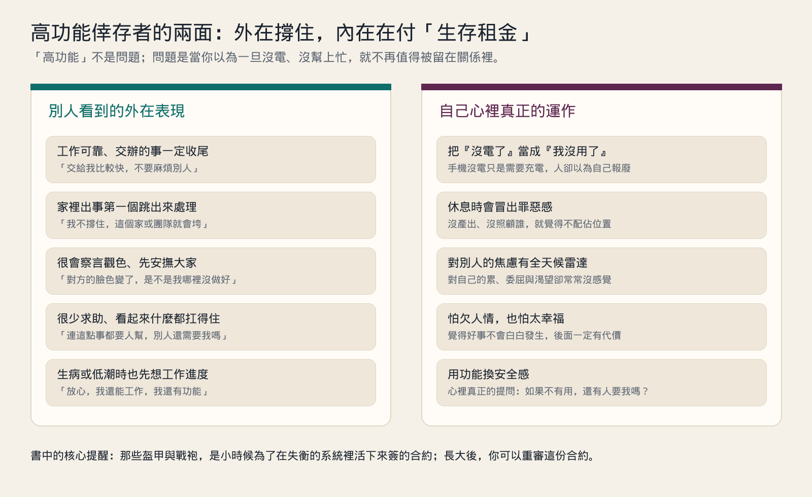
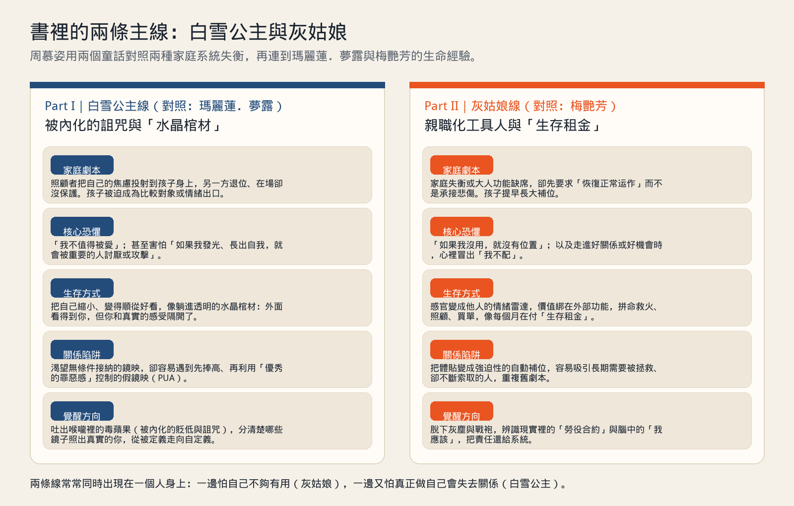
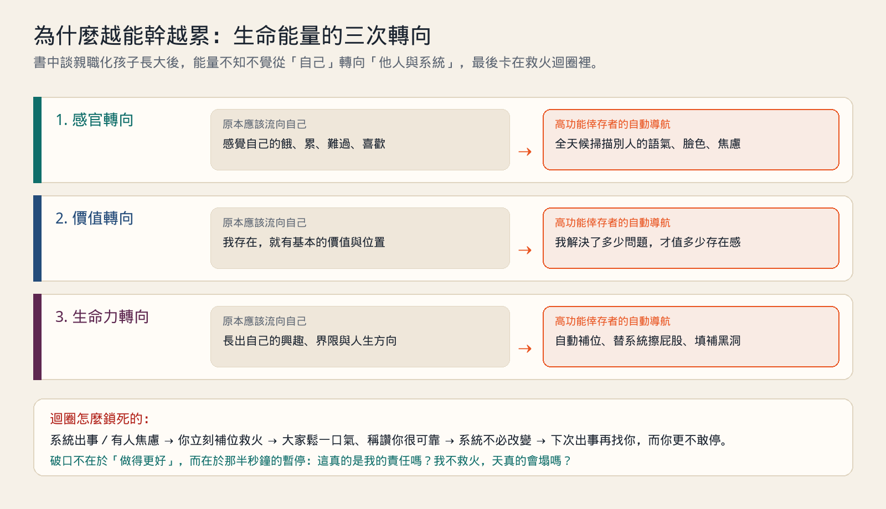
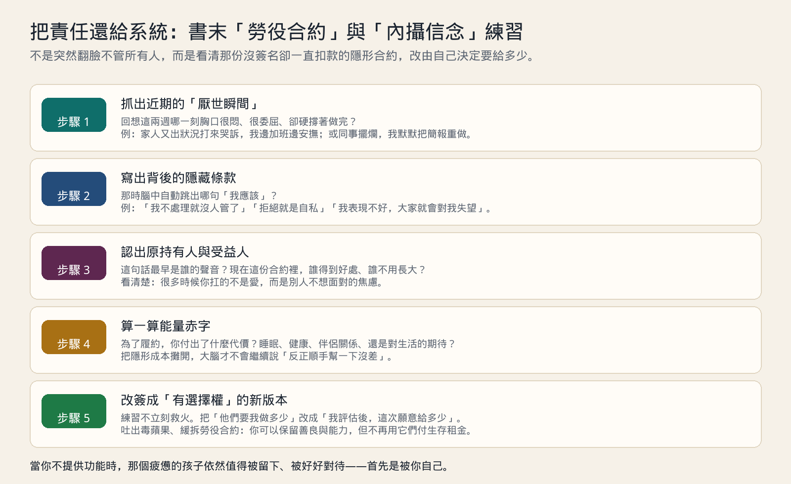

# 《高功能倖存者：如果不「有用」，我還值得被愛嗎？》重點心得

《高功能倖存者：如果不「有用」，我還值得被愛嗎？》是諮商心理師周慕姿在 2026 年 6 月出版的作品（寶瓶文化，304 頁）。她過去寫過《情緒勒索》、《過度努力》、《羞辱創傷》、《親密恐懼》；這一本把鏡頭對準另一群在日常生活裡很少被認為「有問題」的人——那些在職場很可靠、在家庭很能扛、事情交到他手上就一定有結果，卻總是在夜裡覺得自己快要沒電的人。

書名的提問很直接：**如果有一天我沒有幫上忙、沒有撐住場面、沒有提供功能，我還可以安心待在一段關係裡嗎？**

這篇是讀書心得與生活整理，不能取代專業心理諮商。若讀的過程中覺得某些段落太貼近自己、身體出現明顯的緊繃或喘不過氣，先停下來休息；需要時，找合格的心理師或精神科醫師談，會比自己硬撐著讀完更重要。

## 什麼是「高功能倖存者」

「高功能」指的是外在運作良好：能上班、能照顧人、能把混亂收乾淨，甚至常被稱讚成熟、懂事、抗壓。「倖存者」指的則是內在狀態：這份能幹並不是出於從容的自我實現，而是早年在失衡的環境裡，為了活下來、為了不被丟下而練出來的求生方式。

周慕姿在書裡講了一個很傳神的比喻：一支手機沒電了，我們只會說「它需要充電」，不會說「這支手機沒有功能，該丟掉了」。但高功能倖存者一旦覺得累、生病、想拒絕別人，心裡跳出來的卻常常是：「我是不是沒用了？」

最讓人心疼的，是書裡點出的那句自我安撫——當他們感覺到脆弱、孤單或撐不下去時，安慰自己的話竟然是：「放心，我還能工作，我還有功能。」

先用下面四個日常場景，對照看看這種運作方式：

| 場景 | 一般人的累 | 高功能倖存者的反應 |
| --- | --- | --- |
| 發燒請假在家 | 睡覺、追劇，把病養好 | 躺在床上一直滑工作訊息，怕同事覺得自己麻煩 |
| 家人打電話抱怨家務或債務 | 聽完安慰幾句，請當事人自己處理 | 一邊加班一邊想辦法匯錢、聯絡、排解，掛掉電話後胸口發悶 |
| 朋友臨時約吃飯，自己其實很累 | 說「我今天想早點睡，下次約」 | 嘴上說好啊，還負責訂位；回家路上覺得全世界都在消耗自己 |
| 伴侶主動幫自己煮一碗麵 | 覺得開心、被照顧 | 心裡先緊一下：「我欠他一次，等一下要把碗洗乾淨、再幫他做點什麼」 |

他們不是不知道休息重要，而是只要一停下來，沒有產出、沒有照顧誰，就會冒出「我不配佔這個位置」的不安。書裡把這種不斷靠付出換取安全感的狀態，稱作在付**「生存租金」**——好像連活在關係裡，都得按月繳費。

## 為什麼會變成這樣：家庭系統裡的三角化與親職化

這本書不只是講個人性格，而是借用 Murray Bowen 的**家庭系統理論**（書中引用了《家庭評估》與 Bowen 八大概念），把問題放回整個「系統」來看。

當一個家庭裡的大人有龐大的焦慮，卻沒有能力自己消化，兩個大人之間又接不住彼此時，系統為了維持表面穩定，常會把第三個人拉進來——通常是最敏感、最懂事、或最沒辦法逃走的孩子。這就是**三角化**，以及把焦慮往下傳遞的**家庭投射歷程**。

在這樣的系統裡，孩子常見兩條求生路線：

1. **縮小自己，不要惹事，變成大人想要的樣子。** 如果我太亮眼、太有主見，大人的焦慮就會爆發；那我就乖、就順從、就把真實的感覺關掉。
2. **提早長大，代替失能的大人撐住家。** 大人吵架我去勸、媽媽哭我去哄、家裡出事我去扛。這在心理學上叫做**親職化（parentification）**——孩子被迫坐上父母的位置，卻沒有人當他的父母。

這兩條路線，就構成了全書的兩大篇章：**白雪公主**與**灰姑娘**。作者還分別用兩位真實世界的巨星——**瑪麗蓮．夢露**與**梅艷芳**——對照這兩種劇本走到極致時的痛。

## 第一條線：白雪公主與「水晶棺材」

### 家庭劇本：當孩子長出自我，系統就感到威脅

我們小時候讀白雪公主，只覺得王后愛慕虛榮。周慕姿從家庭系統的角度重讀：王后是一個把全部價值都綁在「我必須是第一名」上的高焦慮照顧者；而國王呢？國王幾乎是隱形的——**在場，卻沒有保護功能**。

當父親退位、沒有人能承接王后的焦慮時，漸漸長大的白雪公主就成了那個靶。孩子越長大、越有自己的生命力，照顧者就越覺得被威脅。於是孩子學到一個恐怖的連結：**如果我發光、如果我有自己的樣子，我愛的人就會討厭我，甚至毀掉我。**

### 毒蘋果與水晶棺材

書裡用兩個象徵講「未完成的自我分化」：

- **喉嚨裡的毒蘋果**：那些從小聽到大、最後吞進心裡變成自己聲音的話——「你就是太自私」「你沒有我怎麼辦」「你以為你有多好」。
- **透明的水晶棺材**：為了安全，乾脆把自己凍起來。外面的人看得到你漂亮、乖巧、得體、工作表現好，但你和自己的喜怒哀樂隔著一層厚玻璃。你活著，卻沒有真的在呼吸。

### 生活中的例子：不敢升遷的小芸

小芸在公司是公認最好配合的資深企劃。她的提案常常被主管拿去當範本，但每次主管問她要不要帶小組、要不要上台報告，她都退到後面說：「我比較適合在幕後幫忙。」

真正讓她害怕的不是能力不夠，而是從小只要她考得好、穿得好看，媽媽就會冷冷地說：「現在翅膀硬了，看不起媽媽了是不是？」爸爸則在旁邊滑手機說：「你就順著你媽一點，少講兩句。」

長大後的小芸，只要被稱讚就會全身不自在。在感情裡，她也常遇到同一種人：一開始把她捧上天，說「只有你懂我」；等她投入之後，對方又開始挑剔她「太強勢、不夠體貼、工作那麼忙根本不愛我」。書裡把這種關係陷阱稱作**「假鏡映」與 PUA**：因為小時候沒有得到穩定的接納，長大後一旦有人拿著看似溫柔的鏡子靠近，就很容易把定義自己的權力交出去。

## 第二條線：灰姑娘與「生存租金」

### 家庭劇本：大人要先恢復正常，孩子的悲傷只好自己吞

到了第二部，周慕姿談灰姑娘。故事一開始，灰姑娘的母親過世，父親很快再婚，家裡表面上「恢復正常運作」了，卻沒有人陪這個孩子哀悼。這叫做**功能型遺棄**——大人選擇讓家庭先轉動，而不是陪孩子面對情緒。

在新家庭的不穩定裡，灰姑娘成了維持恐怖平衡的出口：只要有人負責做苦工、負責被嫌棄、負責把豆子挑完，其他人就不必面對彼此的衝突。孩子在這樣的環境裡學會：**我沒有選擇，我唯一能留下來的方法，就是有用。**

### 生命能量的三次轉向

書裡有一段非常清楚的拆解，說明親職化的孩子長大後，生命能量怎麼一步一步從自己身上移開：

1. **感官轉向**：原本感官是用來知道自己餓不餓、累不累、開不開心；後來全部改成「情緒監控雷達」，一進門就先掃描誰臉色不好、誰快要發脾氣。
2. **價值轉向**：原本一個人存在就有基本價值；後來變成「我今天解決了多少問題、幫了多少忙」，才決定我今天配不配休息。
3. **生命力轉向**：原本要用來長出自己興趣與人生的力氣，全部拿去幫系統補位、替別人擦屁股。

作者在這一篇對照的是**梅艷芳**。四歲半就登台唱歌養家、在舞台與朋友之間像戰神一樣豪氣、誰有困難都第一個照顧，卻在面對自己的脆弱與被愛時，一直困在「如果我不夠強、如果我殘缺了，還值得被愛嗎」的追問裡。那件穿在舞台上的婚紗，成了全書最讓人鼻酸的畫面之一。

### 生活中的例子：永遠在救火的大哥阿誠

阿誠是家裡長子，也是部門小主管。弟弟投資失敗欠錢，媽媽第一個打給阿誠哭：「你不管他，我就去死給你看。」在公司，別組留下的爛攤子，老闆也習慣說：「阿誠比較穩，你先頂一下。」

阿誠心裡其實很氣、很委屈，但他的身體比腦袋更快——電話一掛就開始查帳、湊錢；會議一結束就打開別人的檔案重做。做完之後，大家鬆一口氣誇他「還好有你」，弟弟繼續衝動投資，同事繼續準時下班，只有阿誠一個人在深夜胃痛。

這就是圖裡的**救火迴圈**：你越快補位，系統就越不需要長大；系統越不長大，下一次出事就越非你不可。到最後，高功能不再是你的優勢，而是把你綁在火場裡的繩子。

## 為什麼高功能倖存者這麼難開口求助

讀這本書時，我覺得最精準的一點是：高功能倖存者不是沒有痛苦，而是他們的痛苦常常**「沒有觀眾，也沒有語言」**。

當一個平常什麼都做得好的人說「我好累」，身邊最常出現的回應是：

- 「你已經很順了，別想太多。」
- 「你那麼強，這點小事難不倒你啦。」
- 「你不做誰做？大家都靠你耶。」

久而久之，連他自己都相信：**我的脆弱是不合時宜的，我的累是在拿翹。** 於是一有情緒，就立刻切回「解決問題模式」——去加班、去整理家裡、去幫別人忙，用行動把感覺蓋過去。書裡稱這種狀態為高功能下的解離與自動導航：人還在跑，心已經不在場了。

## 怎麼慢慢走出來：把責任還給系統，把疼惜留給自己

這本書沒有要我們把「努力」或「善良」丟掉。周慕姿的做法很務實：**能力是你的資產，但你不該再用它來付生存租金。**

書中在兩大篇最後，分別設計了「我的自定義手冊」（白雪公主篇）與「我的角色謝幕與重啟手冊」（灰姑娘篇）。我把書裡的練習整理成平常在生活裡就能做的五個步驟：

### 1. 先抓出這兩週的「厭世瞬間」

不要從抽象的「我要愛自己」開始，太難了。改從身體感覺開始：這兩週裡，哪一個瞬間你覺得胸口很悶、很想消失、很委屈，手卻還是一直在做？

把那個具體事件寫下來。例如：「禮拜四晚上十點，媽媽又打來講家裡的事，我明天早上九點要簡報，卻還是聽了四十分鐘。」

### 2. 聽見腦袋裡的「隱藏條款」與「毒蘋果」

問自己：那一刻，是什麼念頭逼我不能掛電話、不能說不？

常見的句子長這樣：

- 「我不接，她出事怎麼辦？」
- 「我只是聽一下，連這點事都不做也太自私了。」
- 「如果我沒有把每件事都顧好，他們就會發現我其實沒那麼好。」

這些以「我應該」「我必須」開頭的句子，就是書裡說的**內攝信念**與**喉嚨裡的毒蘋果**。

### 3. 問一句：這份合約是誰寫的？誰在受益？

把上面那句話拿出來看：這個聲音最早像誰？是媽媽、爸爸、老師，還是以前那個很怕被丟下的自己？

接著再問更現實的一題：**當我每次都照這份合約履約時，誰得到好處？誰因此不用面對自己的問題？**

看清楚這一點非常關鍵。因為你會發現，很多時候你以為自己在「愛人」，其實你只是在替整個系統吞下他們不想面對的焦慮。

### 4. 誠實算出你的「能量赤字」

高功能倖存者很會算工作進度、算家裡的開銷，唯獨不會算自己的耗損。請把代價寫出來：

- 我少了幾個小時的睡眠？
- 我對伴侶或小孩變得多沒耐性？
- 我已經多久沒有做一件「純粹只是因為我喜歡、沒有任何用處」的事？

當赤字擺在眼前，大腦才不會繼續騙你說「沒關係啦，我撐一下就過去了」。

### 5. 從「他們要我做多少」改成「我願意給多少」

這一步是整本書從「受害者／工具人」走回「主人」的轉折。

當家人或同事又把焦慮丟過來時，認出另外一個事實：**他們會找你，是因為你有能力，不是因為你天生欠他們。** 既然能力在你手上，選擇權也在你手上。

練習在自動補位之前，先留半秒鐘的空白，把心裡的問句換掉：

| 舊問句（自動導航） | 新問句（拿回主權） |
| --- | --- |
| 他們需要我做什麼？ | 我現在還有多少電？ |
| 我不做會不會被討厭？ | 這件事本來是誰的責任？ |
| 怎麼把這場火撲滅？ | 以我現在的狀態，我願意幫到哪裡就好？ |

例如阿誠不必一夕之間跟家裡斷絕往來，那反而會引發更大的系統反撲與罪惡感。他可以先從「不立刻救火」開始：媽媽打來哭時，先說「媽，我現在在忙工作，晚上九點我聽你說二十分鐘；但弟弟的錢我這次不會代墊，我們只能一起想他自己怎麼還。」

會有罪惡感嗎？一定會。對高功能倖存者來說，**出現罪惡感，往往不是因為你做錯事，而是因為你第一次沒有照舊合約演出。**

## 我讀完留下的四個重點

1. **「有用」曾經救過你，不必否定它。** 小時候的你沒有資源，只能靠懂事、能幹、縮小自己來換取安全。先謝謝那個孩子撐過來了，現在長大的你，才有餘裕換一種活法。
2. **區分「沒電」與「沒價值」。** 累了、病了、不想講話、不想幫忙，只是電量見底，不是人格破產。
3. **別人的焦慮，不等於你的緊急事件。** 有人在急、在哭、在生氣，你可以理解，但不需要每次都把方向盤搶過來開。
4. **真正的親密，不需要交出功能當門票。** 一段健康的關係，應該容得下你的普通、你的搞砸、以及你偶爾什麼都不想做的樣子。

如果你習慣把每一天都活成待辦清單，這本書最溫柔的地方，是它沒有再給你一張「如何成為更好的人」的清單。它只是陪你把身上穿太久的盔甲一件一件認出來，然後問你：

**當你不當英雄、不當救火隊、不當那個永遠懂事的人時，你願不願意先把自己留下來？**

## 資料來源

- 周慕姿，《高功能倖存者：如果不「有用」，我還值得被愛嗎？》，寶瓶文化，2026 年 6 月。書籍介紹與目次參考：[博客來](https://www.books.com.tw/products/0011052184)、[城邦讀書花園](https://www.cite.com.tw/book?id=107748)、[金石堂試閱](https://www.kingstone.com.tw/basic/freeread/2800000245098/)。
- 理論背景參考：Kerr, M. E., & Bowen, M. (1988), *Family Evaluation*；江文賢主編（2013），《Bowen 家庭系統理論之八大概念》。
