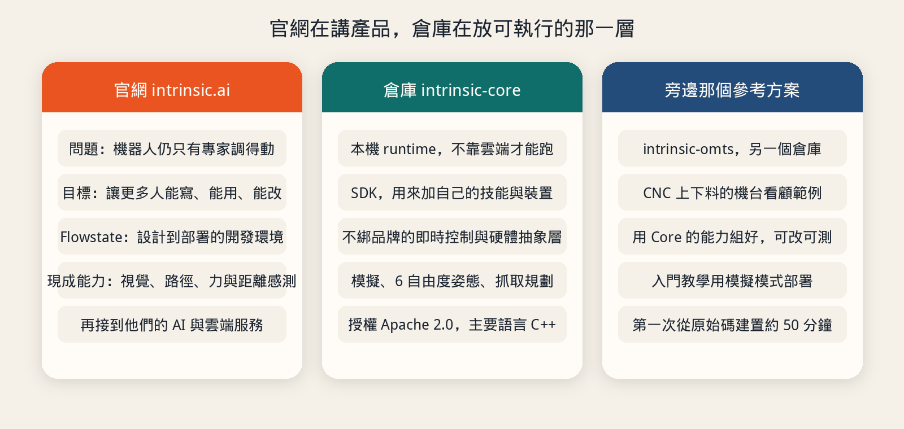
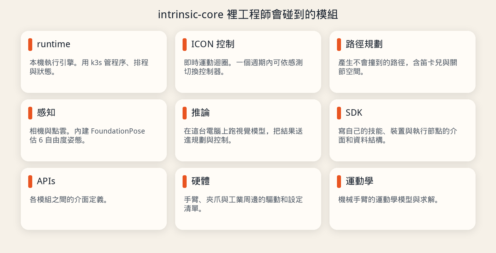
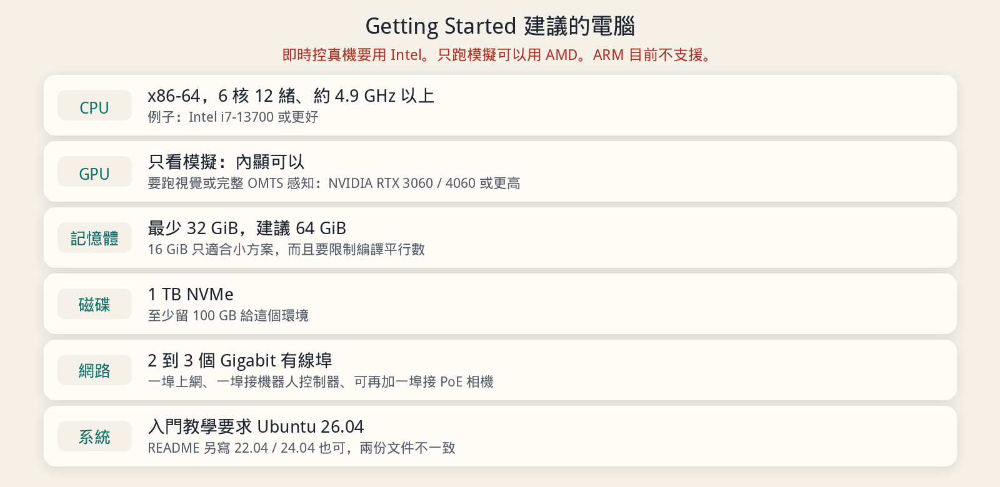

# 簡介 Intrinsic 與 intrinsic-core

這篇先看 [Intrinsic 官網](https://www.intrinsic.ai/) 在講什麼，再看 [intrinsic-ai/intrinsic-core](https://github.com/intrinsic-ai/intrinsic-core) 這個倉庫實際提供什麼、要什麼機器。寫法比照一般的 GitHub 專案介紹：先講它解決什麼問題，再講模組、規格和相關倉庫。

這不是安裝手冊。要在機器上跑起來，直接照倉庫裡的 [Getting Started](https://github.com/intrinsic-ai/intrinsic-core/blob/main/developer_resources/learn/tutorials/getting_started.md)。

資料對照日期是 2026-10-16。星星數、發行版標籤和文件內容都會變，以倉庫當下的檔案為準。

## 官網在做什麼

[intrinsic.ai](https://www.intrinsic.ai/) 把問題講得很直接：工業機器人現在是專家和有多年經驗的公司在用。對很多用得上機器人的人來說，它仍然難寫、難用、難改。他們要做的是把這件事變得比較像在寫軟體，而不是每換一個工件就重教一次機器人。

官網上和工程師有關的東西，可以分成三層。

**Intrinsic Core。** 官網首頁稱它是一組開源、相容 ROS 的能力，用來做實體 AI（Physical AI）。專頁 [intrinsic.ai/intrinsic-core](https://www.intrinsic.ai/intrinsic-core) 寫得更具體：感測控制、感知、運動規劃、抓取規劃都包含在內，不用從空的堆疊自己接起來。裡面有模擬、數位雙生（digital twin），以及一套不綁特定硬體的即時控制框架。

**現成、可以組合的能力。** 首頁列了三項：

- 感知：用 AI 估物體姿態，官網的說法是點幾下就能訓練。
- 運動規劃：在限制條件下自動產生不會碰撞的路徑。
- 感測控制：用力、扭矩和距離感測即時修正動作。

專頁再補上幾件實作時會碰到的事：用 NVIDIA FoundationPose 做 3D 姿態，讓零件不必先用治具夾死；依力量感測做插入和細操作；用 Gazebo 看模擬、除錯狀態機和工作站；校正相機並對齊實體工作站；夾爪依感測適應零件的位置和姿態。

**Flowstate。** 首頁把它寫成從設計到部署的開發環境，用來做可上線的自動化方案。Core 做出來的方案，官網說可以接到 Intrinsic 的其他產品，包括進階 AI 模型、Flowstate 和他們的雲端服務。Flowstate 這篇沒有看到公開原始碼。下面介紹的 GitHub 倉庫是 Core，不是 Flowstate。

官網也有一項 AI for Industry Challenge，給想用這些工具解工業問題的人參加。另外點名了一批合作對象：NVIDIA、Universal Robots、FANUC、ATI、Schunk、Robotiq、Basler。這是生態系名單，不是一張「這些型號都已支援」的相容表。

他們拿來當範例的工業場景是機台看顧（machine tending）：加工廠要人把料放進 CNC、做完再拿出來。官網希望這類上下料不要每換一種工件就重寫一次機器人程式。對應的開源範例不在 Core 倉庫裡，而在 [intrinsic-omts](https://github.com/intrinsic-ai/intrinsic-omts)。

## 這個倉庫是什麼

[intrinsic-ai/intrinsic-core](https://github.com/intrinsic-ai/intrinsic-core) 是 Intrinsic Core 的原始碼。倉庫自己的說明是：一套開放的本機 runtime、SDK，以及不綁硬體的即時控制框架，用來做工業機器人。目標是少花時間在接線和環境，把時間放在應用本身。模擬、6 自由度感知，到真正驅動硬體，都在這套基礎裡。

2026-10-16 看到的倉庫輪廓：

| 項目 | 內容 |
| --- | --- |
| 網址 | <https://github.com/intrinsic-ai/intrinsic-core> |
| 說明文件站 | <https://developer.intrinsic.ai/> |
| 授權 | Apache 2.0 |
| 主要語言 | C++。其次是 Go、Starlark（Bazel 的建置檔）、Python |
| 預設分支 | `main` |
| 星星 / fork | 約 578 / 68（會變） |
| 建置與執行 | Bazel，runtime 跑在 k3s（精簡版 Kubernetes）上 |

用工程師比較熟的話來說：你如果自己用 ROS 2 組一個工作站，通常要分別處理驅動、運動規劃、視覺、模擬和即時迴圈，再把程序怎麼起來、掛掉怎麼辦自己管好。這個倉庫把這些收成可以在一台工控電腦上本地跑的環境。runtime 不依賴雲端才能運作。

README 另外寫了一句需要注意的話：這不是 Google 正式支援的產品。Intrinsic 和 Intrinsic Core 是 Intrinsic Innovation LLC 的商標。

## 主要做哪些事

README 把能力分成這些目錄。官方架構圖在倉庫的 `developer_resources/img/intrinsic_core_architecture.png`。

| 模組 | 你可以把它想成 |
| --- | --- |
| `intrinsic_runtime` | 本機執行引擎。包成 k3s 環境，負責程序生命週期、事件排程、應用狀態。ROS 2 上面這層不用自己從零接。 |
| `intrinsic_control`（ICON） | 即時運動與硬體協調。運動學、軌跡插值，以及一個能在單一週期內依感測切換控制器的控制迴圈。底下是硬體抽象層（HAL），換手臂、夾爪或現場匯流排 I/O 時，不必整套驅動重寫。 |
| `intrinsic_motion_planning` | 無碰撞路徑。同一個 API 處理笛卡兒任務和範圍較大的關節空間動作，並把速度、加速度不同的多段動作接成一條可執行軌跡。 |
| `intrinsic_perception` | 相機和點雲的介面，並帶 NVIDIA FoundationPose，對 3D 零件做 6 自由度姿態估計。零件沒有先夾死時，機器人仍要知道它在哪、朝哪邊。 |
| `intrinsic_inference` | 在這台機器上跑模型的服務。把姿態和偵測結果送進後面的規劃與控制，而不是只在離線筆記本裡跑一次。 |
| `intrinsic_sdk` | 寫自己的技能（skill）、硬體資產和執行節點時用的介面、序列化和資料結構。這些節點要能接上數位雙生和 runtime。 |
| `intrinsic_apis` | 介面定義。 |
| `intrinsic_hardware` | 工業周邊的驅動、清單和服務整合。 |
| `intrinsic_kinematics` | 機械手臂的運動學模型與求解。 |

官方詞彙裡，一個 **Solution** 是「完成某項自動化要的軟體加設定」。OMTS 這個 Solution 的任務就是 CNC 上下料。

Core 和 OMTS 是分開的。Core 是平台。OMTS 是用這個平台做的參考工作站，裡面有預先配好的資產、技能和他們建議的做法。入門教學的路徑是：先把 Core 的 runtime 部署起來，再用 Bazel 建置並部署 OMTS。

## 規格與需求

這裡有一份文件不一致，先看這段再買機器或重灌。

- **Getting Started** 寫：Intrinsic Core 需要 **Ubuntu 26.04**。要看模擬畫面，建議裝 Desktop。
- **README 的 Prerequisites** 寫：Ubuntu 24.04 LTS 或 26.04 LTS，並註明 Ubuntu 22.04 LTS 也支援。ROS 2 發行版寫的是 **ROS 2 Lyrical Luth**。

兩份都在同一個倉庫。照入門教學走，用 Ubuntu 26.04。22.04 或 24.04 是否仍走得完現在這份 Getting Started，要以你克隆下來的那份教學為準，不要只靠 README 那一行。

Getting Started 建議的硬體：

| 項目 | 要求 |
| --- | --- |
| CPU | x86-64。6 核 12 緒、4.9 GHz 或更高，例子是 Intel i7-13700 或更好。即時控制真機要 Intel。只做模擬可以用 AMD。ARM 目前明確不支援。 |
| GPU | 一般模擬用內顯即可。機器學習和視覺要獨立 NVIDIA 顯示卡，RTX 3060 或 4060 以上。完整 OMTS 以模擬模式加上感知來跑，必須有獨立 GPU。 |
| 記憶體 | 最少 32 GiB DDR4 或 DDR5，建議 64 GiB。小方案有機會在 16 GiB 上跑，但要限制 Bazel 的平行工作數，而且編譯前先把 Solution 停掉。也可以把編譯和視覺化放到另一台電腦，讓即時控制那台少背一點記憶體。 |
| 磁碟 | 1 TB NVMe，至少空出 100 GB。 |
| 網路 | 建議 2 到 3 個 Gigabit 有線埠。一埠接區網或網際網路，一埠接即時機器人控制器，第三埠可選，用來接 PoE 相機交換器。 |

入門教學還會用到這些軟體，都是在 Ubuntu 上裝：

- Git 和 Git LFS。模型和幾何檔很大，沒拉 LFS 會在載入 mesh 時失敗。
- GitHub CLI（`gh`），用來克隆指定發行版和下載 runtime 套件。
- k3s。`intrinsic_runtime/setup_k3s.sh` 會安裝。Core 的程序以容器跑在裡面。
- `inctl`。Intrinsic 的命令列工具，從同一個發行版下載。
- 若要跑隨附的感知套件，還要執行 `intrinsic_runtime/setup_nvidia.sh`，讓 k3s 看得到 GPU。
- Bazelisk，由它帶 Bazel。教學裡的 OMTS 建置用 `bazel run //:omts_solution`。
- Ubuntu 26.04 上，教學另外做了一個 `libxml2.so.2` 的符號連結，為了對上 OMTS 使用的 LLVM。

教學在 2026-10-16 把 Core 的發行標籤寫成 `20261012.0`，OMTS 則取該倉庫最新的 release。標籤會改，以 Getting Started 裡的 `CORE_TAG` 為準。

OMTS 第一次從原始碼建置，教學寫大約 50 分鐘。它會一併建 Gazebo 和計算幾何等依賴。建完後部署到本機的 Intrinsic Core，預設位址是 `localhost:17080`，模式是 `operation_mode=sim`。模擬模式下，移動指令打到模擬的機器人，相機影像是場景的 3D 渲染，用來在接真機之前先測。

## 相關倉庫

README 列出的是同一組工具，不是這個倉庫的子資料夾：

| 倉庫 | 做什麼 |
| --- | --- |
| [intrinsic-omts](https://github.com/intrinsic-ai/intrinsic-omts) | 機台看顧參考方案 |
| [intrinsic-moveit](https://github.com/intrinsic-ai/intrinsic-moveit) | 把 MoveIt 2 接到 Intrinsic 的運動與抓取規劃 |
| [intrinsic-inference](https://github.com/intrinsic-ai/intrinsic-inference) | 本機模型推論服務和 ROS 2 節點 |
| [icon-hwm-controller](https://github.com/intrinsic-ai/icon-hwm-controller) | ICON 的硬體模組 |
| [icon-shared-memory](https://github.com/intrinsic-ai/icon-shared-memory) | 即時執行緒用的共享記憶體傳輸 |
| [intrinsic-ros-camera-drivers](https://github.com/intrinsic-ai/intrinsic-ros-camera-drivers) | 相容的 ROS 相機驅動 |
| [malloc-guard](https://github.com/intrinsic-ai/malloc-guard) | 檢查即時執行緒有沒有在不該配置堆積記憶體 |
| [sdk-examples](https://github.com/intrinsic-ai/sdk-examples) | Solution Builder Library 的例子 |

社群、教學和討論在 [developer.intrinsic.ai](https://developer.intrinsic.ai)。倉庫裡的教學在 `developer_resources/learn/tutorials`，詞彙表在 `developer_resources/learn/glossary`。

## 授權和貢獻

程式以 Apache 2.0 授權。要送 pull request，需先簽 Google 的貢獻者授權合約（CLA）。程式風格上，貢獻說明要求 C++20。安全問題不要開公開 issue，照 `SECURITY.md` 私下回報。

商標用法看倉庫裡的 `TRADEMARK.md`。再記一次 README 的聲明：這不是 Google 正式支援的產品。

## 來源

- Intrinsic 官網：<https://www.intrinsic.ai/>
- Intrinsic Core 產品頁：<https://www.intrinsic.ai/intrinsic-core>
- 倉庫：<https://github.com/intrinsic-ai/intrinsic-core>
- README：<https://github.com/intrinsic-ai/intrinsic-core/blob/main/README.md>
- Getting Started：<https://github.com/intrinsic-ai/intrinsic-core/blob/main/developer_resources/learn/tutorials/getting_started.md>
- 開發者社群：<https://developer.intrinsic.ai/>
