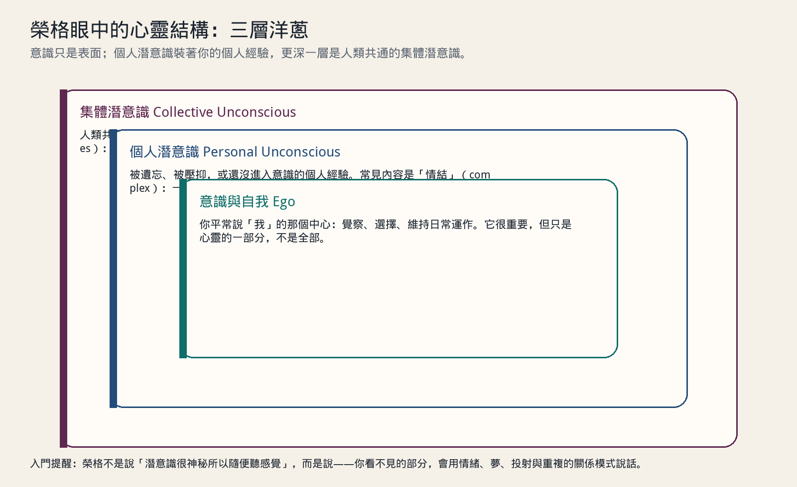
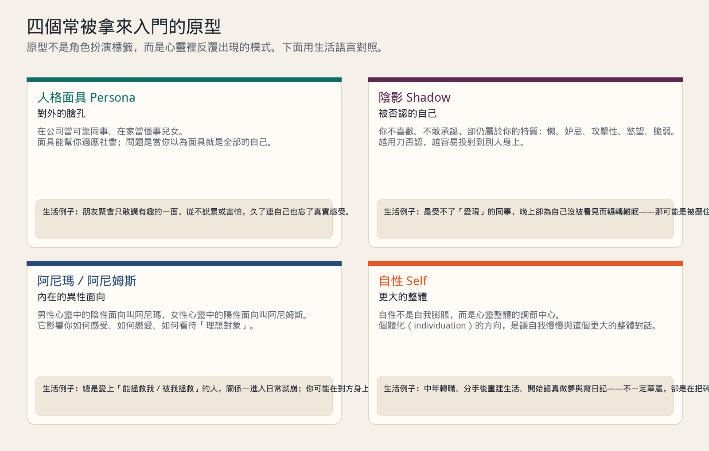
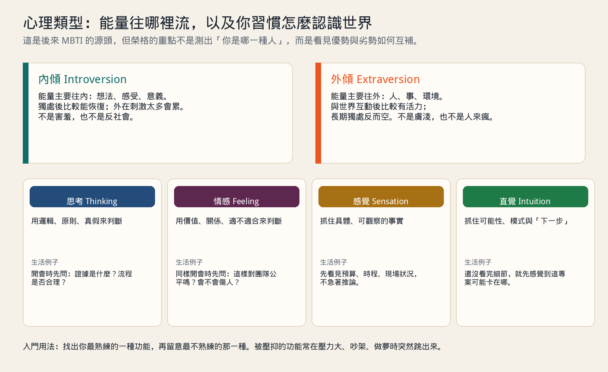
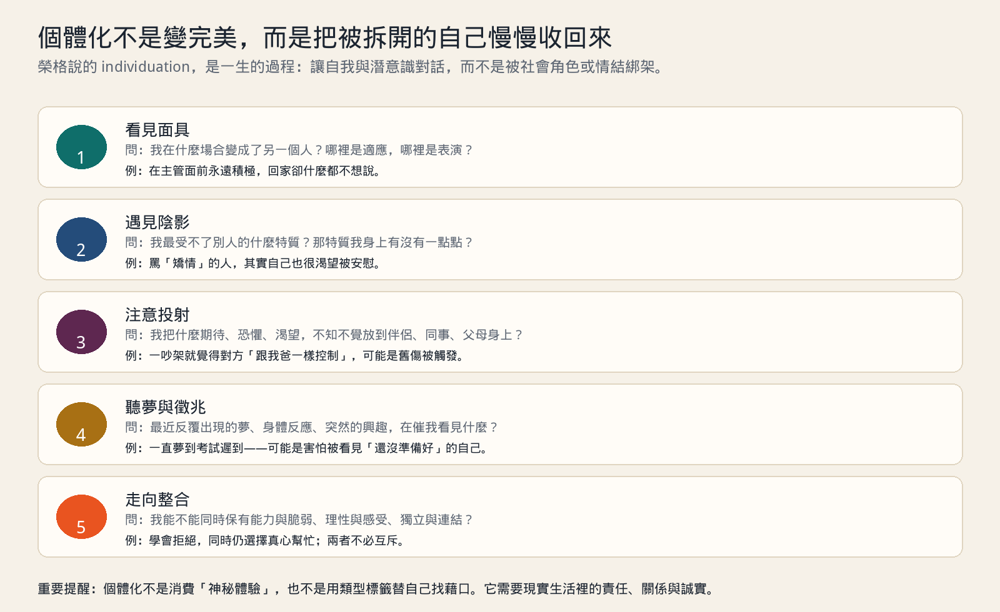

# 榮格心理學入門：想接觸心理學的人，可以從這裡開始

如果你對心理學有興趣，卻常被一堆名詞嚇退——潛意識、情結、原型、內外傾——這篇會用生活語言介紹 **卡爾．榮格（Carl Gustav Jung, 1875–1961）** 的分析心理學（analytical psychology）。目標不是讓你立刻成為分析師，而是先建立一張可用的地圖：心靈有哪些層次、常見的概念在說什麼、以及日常生活裡怎麼開始觀察自己。

這篇是入門導讀，不是心理治療。若你正在經歷嚴重焦慮、憂鬱、創傷反應或自我傷害的念頭，請優先尋求合格的心理師或精神科醫師協助。榮格思想能幫助理解，但不能取代專業評估與治療。

## 榮格是誰？他和佛洛伊德差在哪？

榮格是瑞士精神科醫師，早期曾與西格蒙德．佛洛伊德（Sigmund Freud）密切合作，後來因理論分歧而分道揚鑣。粗略比較：

| | 佛洛伊德精神分析 | 榮格分析心理學 |
| --- | --- | --- |
| 潛意識的重點 | 個人被壓抑的慾望與衝突（尤其性與攻擊） | 除了個人潛意識，還有更深層的**集體潛意識** |
| 發展觀 | 常強調童年與過去如何塑造成人 | 也強調中年之後的意義、整合與成長 |
| 夢與象徵 | 多半朝向被壓抑內容的偽裝與洩露 | 也把夢看作心靈自我調節、指出下一步的訊息 |
| 目標 | 使潛意識變得意識化，減輕症狀 | **個體化**：讓自我與更大的心靈整體對話 |

對入門者來說，記住一句就夠了：**佛洛伊德比較像往「你個人被壓下去的東西」挖；榮格則同時往下挖，也往「人類共通的模式」看。**

## 心靈的三層結構：像洋蔥，不是只有「有意識／沒意識」

### 1. 意識與自我（Ego）

「自我」是你平常說「我」的那個中心：我覺得、我決定、我記得、我要維持今天的會議與晚餐。它很重要——沒有自我，日常生活會崩——但它不是心靈的全部。

生活例子：阿凱白天在客戶面前談得很好，晚上卻突然為一句無關緊要的批評失眠。意識層面「我知道那句話不重要」，身體與情緒卻不聽。這時不是意志力不夠，而是有別的層次在說話。

### 2. 個人潛意識（Personal Unconscious）

這裡裝的是屬於你個人的、卻還沒進入意識或被擠出去的內容：遺忘的事、壓抑的情緒、還沒消化的經驗。榮格特別重視其中的**情結（complex）**——一碰到某個主題，情緒就不成比例地炸開。

生活例子：同事只是提醒「這份報表再檢查一次」，你卻覺得被徹底否定，整天提不起勁。檢查一下歷史：也許國中老師當眾羞辱過你的作業、家裡只在成績好時才給溫暖。那個「被否定」的情結被觸發了，反應才會比事情本身大很多。

### 3. 集體潛意識（Collective Unconscious）

這是榮格最常被誤解、也最有特色的一層。他認為除了個人經驗，還有一種人類共通的深層結構；其中的內容稱為**原型（archetypes）**——不是天生就記得的具體故事，而是容易一再出現的模式與形式。

可以這樣理解：每個文化都有「英雄上路、迷路、遇見陰影、返回」的故事骨架。細節不同，骨架卻相似。榮格說的不是「你前世當過英雄」，而是心靈裡有某些現成的軌道，會在夢、神話、藝術與危機時刻顯現。

## 四個入門最實用的原型

原型很多，入門先掌握這四個就夠用。它們不是給自己貼標籤的角色卡，而是觀察「我現在卡在哪一種模式」的工具。

### 人格面具（Persona）：你對外戴的臉

Persona 原意接近「演員的面具」。你在公司是可靠工程師，在家族群組是「最懂事的那個」，在社群媒體是幽默的人。面具幫助你適應社會，本身無罪。

問題出現在兩種極端：

- **只剩面具**：別人稱讚你，你卻覺得自己是空的；一放假就不知道自己是誰。
- **完全拒絕面具**：以為「真實」就是不顧場合把所有情緒倒給別人，結果關係與工作一起受傷。

生活例子：小恩在聚會永遠是氣氛擔當。有一次她說「我最近其實蠻累的」，朋友愣住說「你不是最開心的那個嗎？」她回家才發現：自己連累了多久，都不敢讓面具裂開。

### 陰影（Shadow）：你不承認、卻仍屬於你的部分

陰影是意識自我說「那不是我」的特質：懶、貪、妒、攻擊、脆弱、慾望、控制欲……。陰影不一定「邪惡」，很多時候只是不合你理想形象的自己。

最常見的現象是**投射**：你越用力否認某特質，越容易在別人身上放大看到它，並強烈厭惡。

生活例子：阿哲最受不了「愛現」的同事。某天夜裡他翻社群，發現自己一直在等別人按讚，沒人回應就焦慮。他厭惡的「愛現」，可能正是自己被壓住、想被看見卻不敢承認的渴望。

與陰影工作，不是放縱傷害別人，而是先誠實承認：「這也是我的一部分。」承認之後，你才有機會選擇怎麼表現，而不是被它從後門控制。

### 阿尼瑪與阿尼姆斯：內在的異性面向

榮格用 **阿尼瑪（Anima）** 指男性心靈中的陰性面向，用 **阿尼姆斯（Animus）** 指女性心靈中的陽性面向。今日我們閱讀時，不必僵化成「男／女天生如此」的刻板印象；更實用的讀法是：**每個人內在都有被文化標成「陽剛／陰柔」的能量，戀愛與親密關係常會把它們戲劇化地投射出去。**

生活例子：美玲總是愛上「很會扛、很會下決定」的人，一旦對方變成需要被照顧、會脆弱的普通人，她就失望到想逃。她在對方身上找的，可能是自己還沒整合的決斷與力量，而不只是「遇人不淑」。

### 自性（Self）：比「我」更大的整體

自我（Ego）是日常的「我」；自性（Self）則指向心靈整體的調節中心——包含意識與潛意識。它不是自我膨脹（「我最特別」），比較像羅盤：在人生轉折時，透過夢、症狀、突然的興趣與意義感，把你往更整合的方向推。

生活例子：四十歲的俊宏穩定升遷，卻反覆夢到自己走錯考場、找不到座位。現實上他「什麼都有了」，夢卻在說：某個更真實的自己還沒入場。後來他不是衝動辭職，而是開始認真評估興趣、界線與關係——這比一夜開悟更接近榮格說的方向。

## 心理類型：內外傾，加上四種認識世界的方式

很多人第一次接觸榮格，是透過後來發展出的 MBTI。請先分清楚：

- **榮格原意**：描述能量方向與心理功能，幫助理解衝突與互補。
- **測驗文化**：容易變成「我是某某型，所以我天生不能怎樣」的藉口。

### 內傾與外傾：能量往哪裡流

- **內傾**：能量主要朝向內在世界。獨處、深度思考後比較能恢復；刺激太多會耗竭。
- **外傾**：能量主要朝向人與環境。互動、行動後比較有活力；長期隔離會空轉。

內傾不是害羞，外傾不是膚淺。一個內傾的業務可以很專業地對外溝通；一個外傾的工程師也可以寫很深的程式——差別在「充電方式」與「注意力預設落點」。

### 四種功能：你習慣怎麼抓取現實

| 功能 | 在做什麼 | 生活例子 |
| --- | --- | --- |
| 思考 Thinking | 用邏輯、原則、真假判斷 | 開會先問證據、流程、因果 |
| 情感 Feeling | 用價值、關係、適不適合判斷 | 開會先問對人公不公平、會不會傷關係 |
| 感覺 Sensation | 抓住具體、可觀察的事實 | 先看預算、時程、現場，不急著推論 |
| 直覺 Intuition | 抓住可能性、模式與「下一步」 | 細節還沒齊，已感覺專案卡點在哪 |

入門用法很簡單：

1. 找出你最熟練的一種（做事時幾乎不用想）。
2. 找出最不熟練的一種（一用就累、就煩、就想逃避）。
3. 觀察壓力大時，劣勢功能如何「爆衝」——例如平常很理性的人，一吵架就變成全盤價值審判。

## 個體化：一生的整合過程，不是變完美

榮格把人生後期很核心的目標稱為 **個體化（individuation）**：不是變成沒有缺點的聖人，而是逐漸把被社會角色、家庭期待與情結拆開的自己，慢慢收回來，成為更完整、更負責的一個人。

可以用五個問題當日常練習：

1. **看見面具**：我在什麼場合變成另一個人？哪裡是必要的適應，哪裡是表演到失真？
2. **遇見陰影**：我最受不了別人的什麼？那特質我身上有沒有一點點？
3. **注意投射**：我把什麼期待或恐懼放到伴侶、同事、父母身上？
4. **聽夢與身體**：反覆出現的夢、突然的興趣、莫名的身體緊繃，在催我看見什麼？
5. **走向整合**：我能不能同時保有能力與脆弱、理性與感受、獨立與連結？

生活例子：雅婷習慣當「好女兒／好同事」，從不惹麻煩。某次她對媽媽說「這週末我想自己待著」，電話那頭沉默很久。罪惡感湧上來時，她沒有立刻撤回，而是寫下：罪惡感出現，代表我碰到舊合約了——不是我變成壞人。這一步，就是很小的個體化。

## 榮格思想常被誤解的地方

1. **「集體潛意識＝前世記憶／通靈」**  
   榮格談的是心理結構與象徵模式，不是要你放棄現實檢驗。入門時先把重點放在「可觀察的情緒、夢與關係模式」。

2. **「陰影工作＝放縱黑暗面」**  
   認識陰影是為了減少投射與自我欺騙，不是合理化傷害。你可以承認自己有怒氣，同時選擇不砸東西、不辱罵。

3. **「測出類型＝人生定論」**  
   類型是地圖，不是牢籠。榮格本人強調發展較弱的功能，而不是永遠待在舒適區。

4. **「個體化＝自私地只顧自己」**  
   真正的個體化通常會讓人更有界線，也更有能力真誠地愛人；它反對的是被角色綁架，不是反對責任。

5. **「自己讀幾本就能分析別人」**  
   用概念觀察自己可以；拿原型去替親友貼標、下診斷，很容易變成新的暴力。

## 想繼續接觸，可以怎麼開始

### 日常三件小事

1. **夢的速記**：醒來先寫關鍵畫面與情緒，不急著「解正確答案」。問：「這個夢像在提醒我白天忽略了什麼？」
2. **情緒放大鏡**：當反應遠大於事件，寫下「觸發事件／身體感覺／腦中句子／這像不像舊經驗」。
3. **厭惡清單**：列出你最受不了的三種人，各寫一句「如果這也是我的一部分，它可能在保護／渴望什麼？」

### 進階閱讀（由易到難）

- 入門概說：榮格自傳《回憶．夢．省思》（Memories, Dreams, Reflections）——先認識這個人如何活進自己的理論。
- 概念地圖：Anthony Stevens 等榮格取向入門書、或《The Handbook of Jungian Psychology》這類概念手冊。
- 原典選讀：  
  - 《Psychological Types》（《心理類型》）談內外傾與四功能  
  - 《Two Essays on Analytical Psychology》談自我與潛意識、個體化  
  - 《The Archetypes and the Collective Unconscious》談原型與集體潛意識  

中文世界也有不少導讀與講座；選讀時優先找有臨床訓練背景、願意標明「詮釋」而非「唯一真理」的作者。

### 什麼時候該找專業協助

- 情緒或症狀已經影響睡眠、工作、安全。
- 創傷記憶反覆侵入，靠自助練習越做越不穩。
- 你想做深度的榮格取向心理治療（分析）——這需要受訓的分析師／心理師，不是網路上的類型測驗。

## 這篇怎麼用

1. 先記住三層結構：意識／個人潛意識／集體潛意識。
2. 用人格面具、陰影、阿尼瑪／阿尼姆斯、自性，觀察自己一週的關係與情緒。
3. 辨認你的優勢功能與劣勢功能，不急著貼 MBTI 標籤。
4. 把個體化當成長期練習：多一點誠實，少一點自我欺騙。
5. 有需要時求助專業；心理學入門的目標是活得更清楚，不是把自己變成診斷機器。

如果你只帶走一句話，我會選這句：

**榮格心理學要問的不是「我有沒有問題」，而是「我還有哪些部分沒被看見，卻一直在影響我的選擇？」**

## 資料來源與延伸

- C. G. Jung, *Psychological Types*（Collected Works, Vol. 6）
- C. G. Jung, *Two Essays on Analytical Psychology*（Collected Works, Vol. 7）
- C. G. Jung, *The Archetypes and the Collective Unconscious*（Collected Works, Vol. 9i）
- Renos K. Papadopoulos 編, *The Handbook of Jungian Psychology*
- 本站相關閱讀：[《高功能倖存者》重點心得](high-functioning-survivor.md)（談面具、過度負責與界線，可與「人格面具／陰影」對照閱讀）
