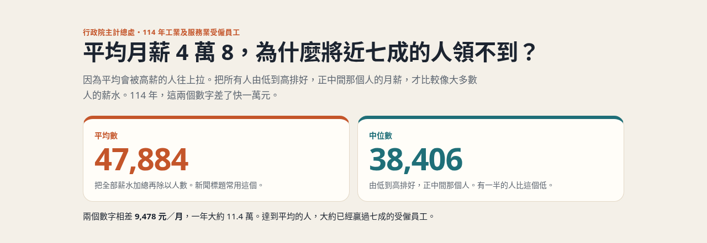
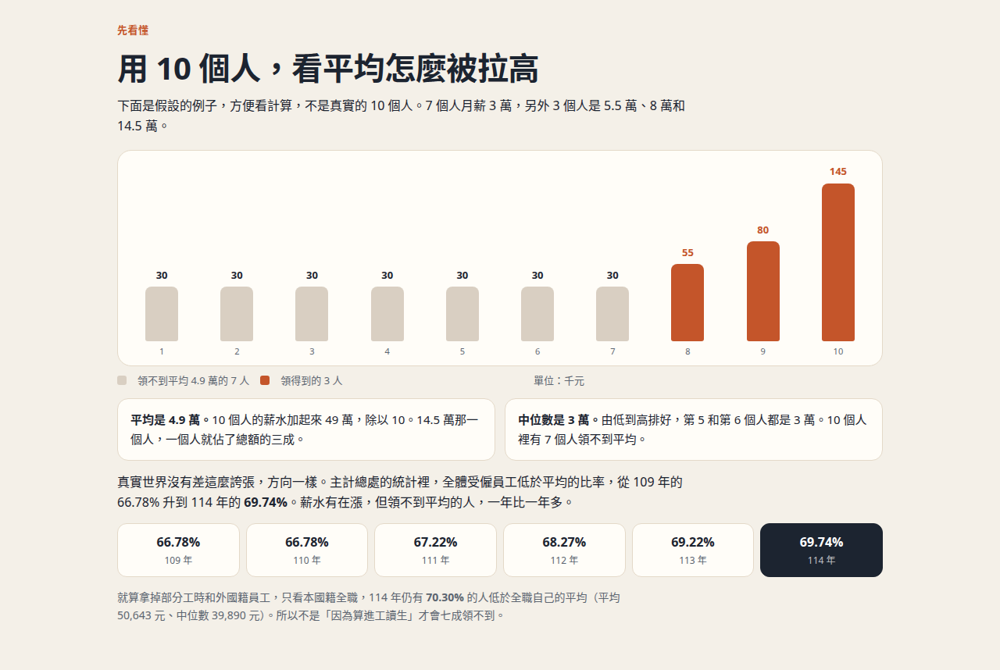
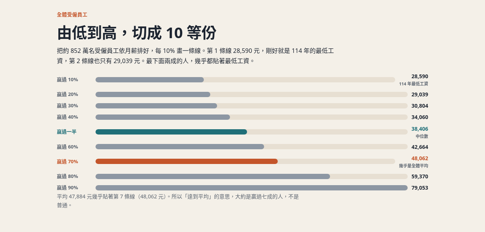
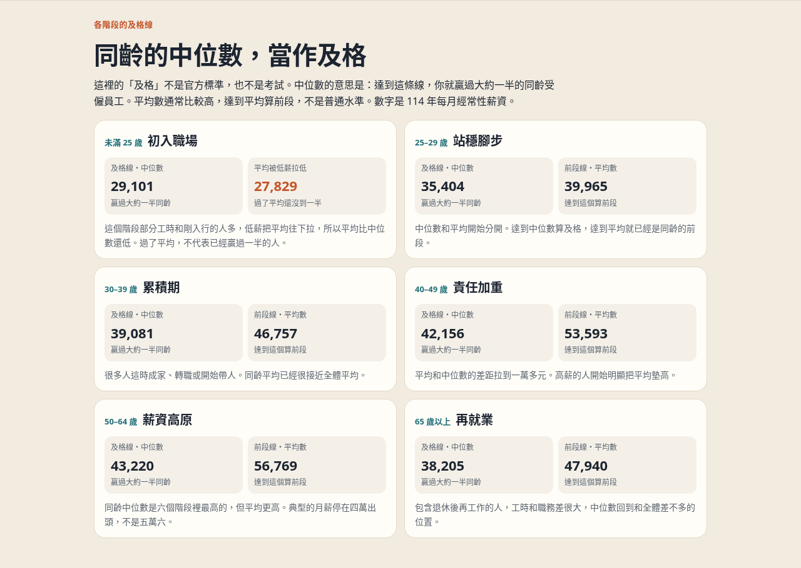
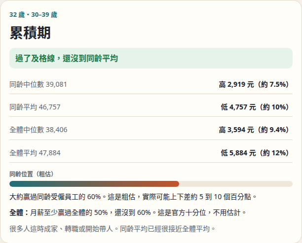

# 平均月薪 47,884 元，為什麼將近七成的人領不到？

2026 年 2 月，主計總處公布 114 年（2025 年）的薪資統計。全體受僱員工每人每月經常性薪資平均 **47,884 元**，比前一年多 3.09%。同一份資料裡，中位數是 **38,406 元**，而且 **69.74%** 的人領不到那個平均。

這就是網路上吵起來的原因：標題說平均月薪快 5 萬，多數人對一下薪資單，對不上。

這篇只用主計總處自己公布的數字，說明平均和中位數差在哪、每個月固定領的和獎金月差在哪，以及每個年齡大概多少算「及格」。最後有一個小工具，輸入年紀和月薪，看你在同齡的哪個位置。

> **線上工具：[你的月薪在同齡的哪裡](https://eddielincursor.github.io/research/salary/)**
> 填年紀和每月經常性薪資（本薪加每月固定津貼），看出在哪個年齡階段、有沒有過同齡中位數，以及大約贏過同齡多少人。

## 先分清新聞裡的三種「月薪」

同一則新聞可能混著三種數字，對不上很正常。

**經常性薪資**，是本薪，加上每月固定發的津貼和獎金。47,884 和 38,406 都是這個。它最接近「平常每個月入帳的薪水」。這篇文章和工具用的都是它。

**總薪資**，是經常性薪資再加加班費、績效獎金、年終。114 年 12 月，全體總薪資平均 62,492 元，其中就有 14,092 元是加班費和獎金。所以「這個月平均 6 萬」常常是獎金月，不是你每個月都領得到的數字。114 年全年總薪資平均 760,632 元，把獎金平均攤進每個月，大約是 6.3 萬，仍然是平均，不是大多數人。

**實質薪資**，是把物價上漲扣掉之後的薪資。114 年經常性薪資平均多了 3.09%，扣掉物價只剩 **1.40%**；中位數實質增加 1.35%。有漲，但沒有標題看起來那麼多。

## 用 10 個人，看平均怎麼被拉高

平均的算法是全部加起來再除以人數。只要有一個人特別高，平均就會被往上帶。中位數是把人由低到高排好，正中間那一個。

下面是假設的 10 個人，方便看計算，不是真實樣本。7 個人月薪 3 萬，另外 3 個人是 5.5 萬、8 萬和 14.5 萬。圖上的數字單位是千元。

10 個人加起來 49 萬，平均 **4.9 萬**。14.5 萬那一個人，一個人就佔了總額的三成。由低到高排好，第 5 和第 6 個都是 3 萬，中位數是 **3 萬**。10 個人裡有 7 個人領不到平均。

真實的差距沒有這麼誇張，方向一樣。114 年全體平均 47,884 元，中位數 38,406 元，一個月差 **9,478 元**，一年大約 11.4 萬。低於平均的比率從 109 年的 66.78%，一路升到 114 年的 69.74%。薪水有在漲，但領不到平均的人，一年比一年多。

| 年 | 低於平均的比率 |
| --- | --- |
| 109 | 66.78% |
| 110 | 66.78% |
| 111 | 67.22% |
| 112 | 68.27% |
| 113 | 69.22% |
| 114 | 69.74% |

有人會說，是因為統計把工讀生和部分工時算進去，才把平均弄得很奇怪。主計總處另外公布了只含本國籍、全職的數字：平均 **50,643 元**，中位數 **39,890 元**，低於平均的比率 **70.30%**。拿掉部分工時和外國籍員工之後，還是約七成的人領不到平均。原因是高薪的人把平均墊高，不是工讀生。

## 由低到高，切成 10 等份

把約 852 萬名受僱員工依月薪排好，每 10% 畫一條線，就是十分位。

| 至少贏過 | 月薪要達到 |
| --- | --- |
| 10% | 28,590（114 年的最低工資） |
| 20% | 29,039 |
| 30% | 30,804 |
| 40% | 34,060 |
| 一半 | 38,406（中位數） |
| 60% | 42,664 |
| 70% | 48,062 |
| 80% | 59,370 |
| 90% | 79,053 |

第 1 條線 28,590 元，剛好是 114 年的每月最低工資；第 2 條線也只有 29,039 元。最下面兩成的人，幾乎都貼著最低工資。115 年 1 月 1 日起，每月最低工資已調到 29,500 元，這份全年統計用的還是 114 年的標準。

平均 47,884 元幾乎貼著第 7 條線（48,062 元）。所以「達到平均」的意思，大約是贏過七成的人，不是普通水準。

## 各年齡多少算及格

這裡的「及格」不是官方標準，也不是考試。我用**同齡的中位數**當及格線：達到這條線，就贏過大約一半的同齡受僱員工。平均數通常比較高，達到平均算前段。

數字是 114 年每月經常性薪資，單位元。

| 階段 | 年紀 | 及格線：中位數 | 前段線：平均數 | 怎麼讀 |
| --- | --- | --- | --- | --- |
| 初入職場 | 未滿 25 歲 | 29,101 | 27,829 | 平均比中位數低。低薪和部分工時把平均往下拉，過了平均還沒贏過一半 |
| 站穩腳步 | 25–29 歲 | 35,404 | 39,965 | 達到 35,404 算及格，達到 39,965 是前段 |
| 累積期 | 30–39 歲 | 39,081 | 46,757 | 同齡平均已經很接近全體平均 |
| 責任加重 | 40–49 歲 | 42,156 | 53,593 | 平均和中位數差到一萬多元 |
| 薪資高原 | 50–64 歲 | 43,220 | 56,769 | 同齡中位數最高，但典型月薪是四萬出頭，不是五萬六 |
| 再就業 | 65 歲以上 | 38,205 | 47,940 | 含退休後再工作的人，中位數回到和全體差不多 |

可以看出兩件事。

第一，中位數從 25 歲之後上升得很慢。25–29 歲 35,404，到了 50–64 歲也只有 43,220，二十多年大約多 8,000 元。平均數卻從 39,965 拉到 56,769。年紀越大，高薪的人把平均墊得越高，典型的月薪沒有跟著漲那麼多。

第二，未滿 25 歲是唯一平均比中位數低的階段。這個階段部分工時和剛入行的人多，少數很低的月薪把平均往下拉。所以這個階段不要用平均當及格，用中位數 29,101 才是「贏過一半」。

還沒到同齡中位數，不代表落後。中位數的定義就是有一半的人在它下面。它是對照用的線，不是該被責備的分數。

## 查你自己在同齡的哪裡

工具在這裡：<https://eddielincursor.github.io/research/salary/>

填兩件事。

1. **年紀**，15 到 80 歲。階段沿用主計總處的分組。
2. **每月經常性薪資**。看薪資單上的本薪，加上每月固定發的津貼。加班費、績效獎金、年終、三節獎金先不要算。那些一個月有、下個月不一定有，算進去會把自己放到比較高的位置。

結果會給四個對照：同齡中位數、同齡平均、全體中位數、全體平均，以及差多少元、差幾個百分比。

同齡的「贏過多少人」是粗估。官方公布了全體的十分位，也公布了各年齡的平均和中位數，但沒有公布各年齡自己的百分位。工具拿全體的分布形狀，再用 113 年各年齡全年總薪資的寬窄去調整。請把它看成一個區間，實際可能上下差約 5 到 10 個百分點。全體那一行則是官方十分位，不用估計。

舉一個例子。32 歲、每月經常性薪資 42,000 元：落在 30–39 歲的「累積期」，比同齡中位數 39,081 元高 2,919 元，還沒到同齡平均 46,757 元。粗估大約贏過同齡的 60%。在全體裡，至少贏過 50%，還沒到 60%。

網址會記住你填的數字，例如 `#a=32&s=42000`，可以存成書籤，明年統計更新前再回來對一次。數字不會上傳。

## 這些數字沒有算到誰

對不到自己的位置，常常是範圍不一樣，不是你算錯。

- **沒有算軍公教。** 這份統計是工業及服務業的受僱員工。公務員、公立學校教師、軍人是另一套薪資制度。
- **沒有算老闆、接案和農林漁牧。** 只算領薪水的受僱員工。
- **行業差很多。** 113 年全年總薪資中位數，金融及保險業 110.6 萬、電子零組件業 87.6 萬，住宿及餐飲業 41.5 萬。同齡比較會把工程師、護理師和餐廳內場放在一起。
- **學歷也差很多。** 同樣是 114 年的每月經常性薪資，研究所中位數 66,667 元，專科及大學 40,605 元，高中職 34,347 元。
- **114 年全年是初步統計。** 主計總處標了初步，之後可能小幅修正。

## 下次看到薪資新聞，可以先問三句

1. 這是**平均**還是**中位數**？平均幾乎等於「贏過約七成的人」，中位數才是正中間。
2. 這是**經常性薪資**還是**總薪資**？總薪資含加班費和獎金，獎金月會高出一截。
3. 有沒有**扣掉物價**？114 年名義上多了 3%，實質大約多 1.4%。

三句都對上了，標題上的數字才跟你的薪資單是同一件事。

## 資料來源

- 行政院主計總處，[114 年受僱員工薪資調查新聞稿](https://www.dgbas.gov.tw/News_Content.aspx?n=3602&s=235863)（115 年 2 月 11 日發布）：全體與本國籍全時的平均、中位數、實質增幅、低於平均比率，以及表 6（年齡、學歷）、表 9（十等分位）。114 年全年為初步統計。
- 行政院主計總處，[113 年工業及服務業受僱員工全年總薪資中位數及分布統計](https://www.dgbas.gov.tw/News_Content.aspx?n=3602&s=235514)：表 3、表 5 的年齡、行業與學歷中位數。同齡百分比的分布形狀用的是這份資料。
- 勞動部，[歷年最低工資](https://www.mol.gov.tw/1607/28162/28166/28180/70460/76761/76833/)：114 年每月 28,590 元，115 年 1 月 1 日起 29,500 元。
