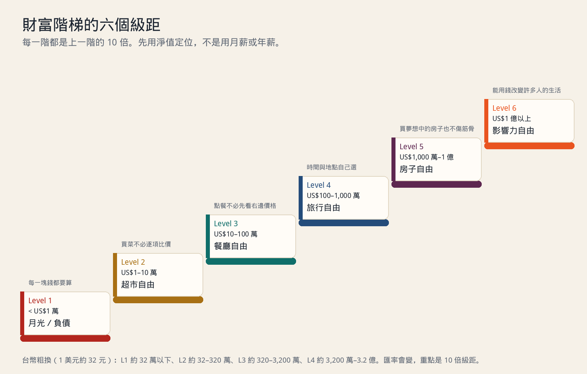
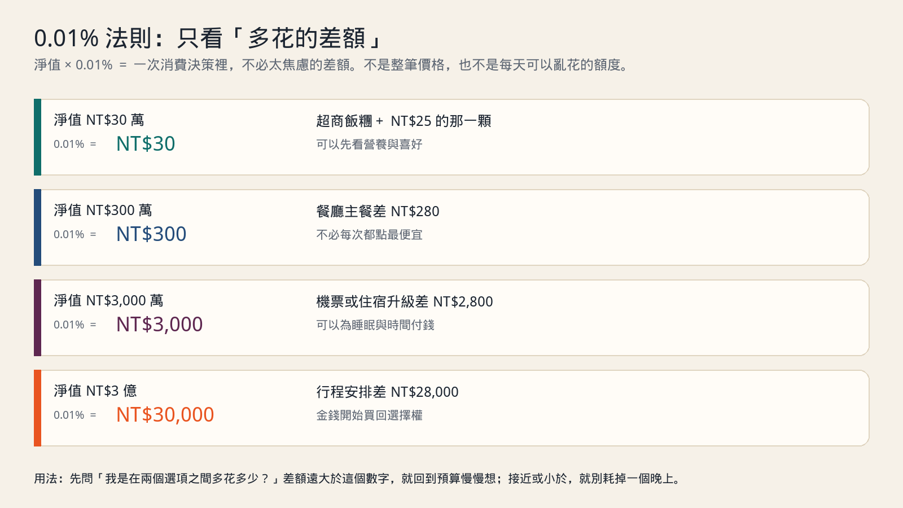
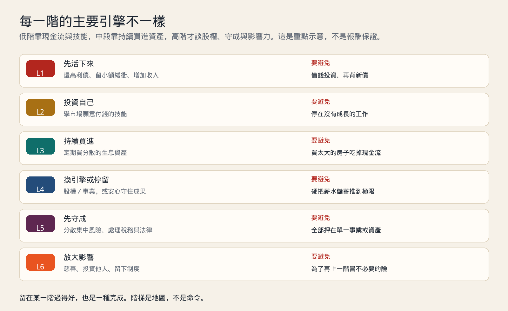
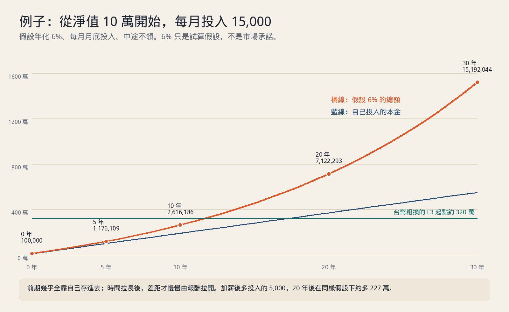

# 《財富階梯》重點心得：先知道自己在哪一階，再決定下一步

《財富階梯》（The Wealth Ladder）的作者 Nick Maggiulli，是 Ritholtz Wealth Management 的營運長與資料科學家，也寫了《持續買進》（Just Keep Buying）和部落格 Of Dollars and Data。他在 2025 年把過去談消費、收入與投資的文章整理成這本書。原書共 214 頁、14 章，分成三部分：先定義階梯，再逐階說策略，最後談怎麼用錢過生活，而不是只把數字堆高。

這本書我最有感的一句話可以濃縮成：**理財建議沒有一套適用所有人；你在哪一階，該做的事就不一樣。**

對淨值還不多的人說「不要太在意一杯咖啡」，可能很輕鬆；對已經很有錢的人說「再省一點就會更有錢」，又可能完全抓錯重點。階梯的用法，是先定位，再選這一階最值得做的槓桿。

這篇是重點心得，不是投資建議。書中的金額是美元，我會換成台幣幫助理解；換算只是粗略對照，真正重要的是每一階相差 10 倍。

> **線上工具：[財富階梯定位器](https://eddielincursor.github.io/research/wealth-ladder/)**
> 填入資產與負債，直接看你在哪一階、擁有哪一種自由、往下一階還差多少，以及照目前的投入大約要幾年。

## 先算淨值：你站在哪一階

《財富階梯》用的是**淨值**，不是月薪，也不是銀行裡看起來最多的那個帳戶。

> 淨值 = 全部資產 − 全部負債

資產包括現金、存款、股票、基金、退休帳戶、自住房；負債包括房貸、車貸、信貸、學貸與卡債。

舉個生活中的例子。小芬有：

| 項目 | 金額 |
| --- | --- |
| 活存與定存 | 180,000 |
| 基金與股票 | 250,000 |
| 自住房目前約值 | 12,000,000 |
| 房貸還欠 | -7,600,000 |
| 信貸還欠 | -200,000 |
| 淨值 | **4,630,000** |

用後面台幣粗換的級距，她的總淨值約落在 Level 3。但要注意，她真正能馬上動用的錢只有存款與投資共 430,000，再扣掉信貸，流動淨值只剩 230,000。房子讓總淨值看起來不低，卻不能拿來付下個月的帳單。

所以我會把兩個數字都算：

- **總淨值**：看自己長期站在哪一階。
- **流動淨值**：現金與可變現投資，減掉短期負債。用它來決定消費與風險，比較保守。

只看總淨值，很容易出現「帳面 Level 3，生活卻像 Level 1」的錯覺。自住房佔比太高的人尤其如此。

## 六個級距：每一階差 10 倍

| 級距 | 書中的淨值（美元） | 台幣粗換 | 作者給的自由 | 生活感覺 |
| --- | --- | --- | --- | --- |
| Level 1 | < 1 萬 | < 約 32 萬 | 月光／負債 | 每一筆錢都要算，突發支出就可能刷卡 |
| Level 2 | 1 萬–10 萬 | 約 32–320 萬 | 超市自由 | 買菜、買日常用品，不必逐項為幾十元猶豫 |
| Level 3 | 10 萬–100 萬 | 約 320–3,200 萬 | 餐廳自由 | 聚餐點想吃的，不必永遠選最便宜的主餐 |
| Level 4 | 100 萬–1,000 萬 | 約 3,200 萬–3.2 億 | 旅行自由 | 旅行時間、地點、住宿有較多選擇 |
| Level 5 | 1,000 萬–1 億 | 約 3.2–32 億 | 房子自由 | 買理想中的房子，也不至於傷到整體財務 |
| Level 6 | 1 億以上 | 約 32 億以上 | 影響力自由 | 能用錢支持他人、投資事業或做大規模公益 |

台幣欄位以 1 美元約 32 元換算，方便台灣讀者抓位置。匯率會變，而且台灣的房價、健保、稅制與美國不同，不需要把門檻當成考試分數。它的用途是提醒你：從 30 萬到 300 萬，與從 300 萬到 3,000 萬，雖然都叫「多一階」，靠的方法不會一樣。

還有一個很容易被忽略的點：同一階裡面也很寬。淨值 40 萬和 300 萬都在台幣粗換的 Level 2，但生活壓力完全不同。階梯適合看方向，不適合拿來排名，更不適合推斷一個人的價值。

## 0.01% 法則：消費看差額，不看整筆價格

書裡我最常拿來用的工具，是 **0.01% 法則**。

> 一次消費決策中「多花的差額」，若只有淨值的 0.01%，通常不必花太多精神焦慮。

淨值 300,000，0.01% 是 30 元。淨值 3,000,000，0.01% 是 300 元。淨值 30,000,000，則是 3,000 元。

關鍵是「差額」，不是整筆消費。

生活裡大概是這樣：

- 在超商拿飯糰，喜歡的那顆比另一顆貴 25 元。若你的淨值是 30 萬，25 元小於 30 元的門檻，這一餐就選喜歡的，不必站在冰櫃前算五分鐘。
- 和朋友聚餐，牛肉麵 320 元、海鮮麵 580 元，差 260 元。若淨值是 300 萬，門檻是 300 元，這次聚餐點海鮮麵，不會改變你的財務人生。
- 出差或旅行時，直達班機比轉機貴 2,800 元。若淨值是 3,000 萬，門檻是 3,000 元，可以把錢花在少折騰、睡飽一點。

反過來，如果差額是門檻的十倍，就不能說「反正我有在投資」然後滑過去。例如淨值 30 萬，買手機時為了更大的容量多花 8,000 元，那不是 0.01%，而是淨值的 2.7%。這筆應該慢慢想，甚至等下一次換機。

這條法則有三個限制：

1. **看的是兩個選項的差額，不是總價。** 不能因為車子總價很高，就把所有升級都說成小錢。
2. **不是每天都花到門檻的許可證。** 每天都多花一筆，年化起來就不是小事。它是幫你減少小決策的焦慮，不是用來合理化固定月支出。
3. **用流動淨值算更安全。** 房子不能賣一塊磁磚來付帳。用存款與投資減掉短期負債，當分母比較踏實。

我喜歡這條法則，是因為它讓「省錢」有了比例感。低淨值時，每一筆差額都要算；淨值慢慢增加後，可以把注意力還給味道、時間與體力，而不是把每一塊錢都守到很累。

## 每一階該做什麼：引擎會換

### Level 1：先活下來，不要先談報酬率

作者給這一階的提醒是：不典型的結果，需要不典型的行動。翻成生活語言就是，若現金流已經卡住，只靠「少喝飲料」通常不夠。

阿哲月入 38,000，房租與基本開銷吃掉大半，還有 120,000 卡債在循環利息裡。他手邊存款 20,000，淨值大約是 -100,000。這時候有人跟他說「每月定期定額 3,000，長期年化多少」，順序就錯了。卡債利息像漏水的桶，投資則像往桶裡慢慢加水。

這一階比較重要的順序是：

- 先停住新增的高利負債，把最低應繳與到期日列出來。
- 賣掉確定用不到的東西、談加班或接短期案子，先換現金流。
- 留一個很小的緩衝，例如先存到一個月必要開銷，避免下一次突發支出又刷卡。
- 再集中還利率最高的債。
- 想學新技能，先找低成本、可驗證的方式，不要再借一筆錢去賭轉職。

「少買一杯 65 元飲料」一個月省約 1,950 元，當然不是零，但若卡債每月利息就吃掉接近這個數字，只談飲料會讓人以為問題是享受太多，而不是債務結構。Level 1 要先把洞補起來。

### Level 2：今天學的東西，會跟著你很久

到了 Level 2，已經有一點緩衝。這一階最大的槓桿，通常不是挑到一檔漲很多的股票，而是讓未來每一個月的收入變高。

小美淨值 680,000，工作做了四年，月薪 46,000。她花 36,000 上一門和工作直接相關的課，加上作品與證照，半年後跳到月薪 54,000 的職位，每月多 8,000。只看加薪，36,000 大約 4.5 個月回本。更重要的是，多出來的 8,000 若從此每月投入，在假設年化 6% 的情況下，20 年後約是 363 萬。這不是保證，而是讓你看見：早期收入曲線往上彎一點，後面會被時間放大。

作者提醒這一階最可惜的，是停在一份沒有成長的工作裡。判斷方式很實際：

- 這份工作還在教你市場願意付錢的技能嗎？
- 薪水與責任有沒有跟著能力走？
- 兩年後，你能拿這段經驗去換更好的位置嗎？

如果三題都是否定的，省下來的投資報酬可能補不過職涯停住的機會成本。當然，不是每個人都要跳槽或創業。重點是把學習當成資產，而不是等公司安排。

### Level 3：持續買進，但不要被大房子吃掉

Level 3 是書名《Just Keep Buying》最能發揮的一階。已經有基本安全網，也有穩定收入，接下來是持續買進分散的、生息的資產，讓錢開始幫忙工作。

這一階的關鍵不是猜下個月漲跌，而是把流程變得無聊：發薪、轉帳、買進、記錄淨值，市場大跌時不把計畫整組刪掉。前一篇[用同一筆薪水看懂 631、333、5311 和其他理財分法](budgeting-ratios.md)，談的就是怎麼先把每個月能投入的金額留下來；順序對了，這一階才走得久。

危險通常不是一杯咖啡，而是大額固定支出。一對伴侶合計淨值 5,200,000，原本每月可投入 30,000。換了更喜歡的房子後，房貸與管理費每月多 18,000，能投入的只剩 12,000。房子不是不能買，但要先承認：買下去之後，爬梯的速度會換一條路，而且未來十幾年都被這筆固定支出綁住。

所以 Level 3 買房、買車、安排小孩教育時，我會先問一句：這筆支出會不會把「持續買進」擠到幾乎歸零？如果會，它就不只是消費選擇，而是把下一階的門先關小了。

### Level 4：帶你來的方法，不一定能帶你走

到了 Level 4，薪水與儲蓄仍然重要，但要再往上跳 10 倍，只靠省與存，通常會很慢。

假設有人淨值 50,000,000，每年能存 1,000,000。即使把投資假設放進去，要碰到台幣粗換 Level 5 的 320,000,000，也往往是數十年的尺度。書中因此談股權與事業：持有公司股份、創業、加入有股權的團隊，讓收入不再只跟工時綁在一起。

但我認為讀這一階要很小心。創業不是「高階版定期定額」，它有失敗、集中與流動性風險。作者真正想說的，我會讀成：你必須承認舊引擎的上限，然後決定要不要換引擎。

不想換，也完全可以。Level 4 已經有旅行自由與很強的生活選擇權。若為了追求 Level 5，把健康、家庭與原本喜歡的工作都押上去，那是價值選擇，不是數學必答題。

### Level 5：只有偏執的人能活下來

這一階常見的來源，是事業做大、出售股權，或長期持有資產累積到很大的金額。問題會從「怎麼賺更多」變成「怎麼不要一次失去太多」。

作者用「只有偏執的人能活下來」提醒這一階的人：最大的風險往往不是報酬太低，而是集中。

全部資產押在自己公司、單一產業、單一國家，或用借來的錢放大部位，年輕時是衝刺，年紀與金額變大後，同一個動作可能變成把全家的安全感押上去。這一階該補的是分散、稅務、法律、保險與接班安排。聽起來不刺激，卻是這一階真正的功課。

### Level 6：影響力等於行動乘以財富

Level 6 的人已經不需要為了生活費做大部分決定。書裡的公式是 Legacy = Action × Wealth。錢很多，但若没有行動，影響仍然有限；錢較少的人，若長期做對的事，也能留下影響。

對大多數讀者來說，這一階不需要當目標清單。它提醒的是最後一件事：財富的用途可以從「我還能買什麼」，慢慢轉成「我能讓什麼事情發生」。

## 爬一階要多久：前期靠存，後期才靠報酬

書裡談爬梯速度時，最重要的提醒是慢。多數人十年內還在同一階，不代表失敗，而是因為每一階本來就差 10 倍。

用一個台灣讀者比較容易代入的例子。假設現在淨值 100,000，每月投入 15,000，年化 6%、每月月底投入、中途不領，結果如下：

| 時間 | 自己投入的本金 | 假設 6% 時的總額 |
| --- | --- | --- |
| 5 年 | 1,000,000 | 約 1,176,109 |
| 10 年 | 1,900,000 | 約 2,616,186 |
| 20 年 | 3,700,000 | 約 7,122,293 |
| 30 年 | 5,500,000 | 約 15,192,044 |

前五年，總額裡大部分是你自己存進去的。這也是為什麼在 Level 1 與 Level 2，花精神挑投資商品，常常不如先把收入與儲蓄率拉起來。到了後面，報酬才慢慢變成明顯的一塊。

同一個例子裡，若加薪後每月多投入 5,000，在同樣假設下，20 年後約多 2,270,000。對 Level 2 的人來說，一門能換來長期加薪的課，可能比在投資帳戶裡多研究一個月更值得。這就是「每一階的引擎不同」最實際的樣子。

要自己換數字，可以用理財篇附的[薪水分配與投資試算](https://eddielincursor.github.io/research/budget/)：先在上面把每個月投資那一格算出來，再往下看不同年數與假設報酬率的結果。記得把報酬率當情境，不要當承諾。

## 錢像鹽：它放大你原本的生活

書裡有一個我很喜歡的比喻：鹽不會替食物創造味道，它是把原本的味道放大。錢也類似。

錢可以減少很多煩惱：不用為修車錢焦慮、可以請家人吃飯、生病時不用先算存款。但如果原本的生活裡沒有關係、健康、時間與能投入的事，錢變多，只會把空缺照得更清楚。

作者談的不只是財務上的財富，還包括時間、社交、心理與身體。我的讀法是：

- 財務財富，是讓你有選擇。
- 時間財富，是你能不能決定今天怎麼過。
- 社交財富，是有沒有能一起吃飯、互相幫忙的人。
- 身體與心理財富，是你還有沒有力氣享受前面三種。

這也是為什麼我不建議把「升一階」當成人生 KPI。階梯能幫你找到下一步，但不該替你定義什麼叫過得好。

## 我對這本書的保留

**第一，級距是美國尺，台灣要自己調整。**

美國的醫療、學貸、稅制與房價結構和台灣差很多。台灣有健保，醫療破產的路徑不同；但雙北房價又可能讓自住房把淨值推得很高，生活現金流卻還是很緊。用台幣換算只是起點，最好同時看流動淨值與每月現金流。

**第二，10 倍級距太寬，不能只看階級名稱。**

淨值從 350,000 到 3,000,000 都可能被我粗分在 Level 2，但前者要先顧緩衝，後者已經能穩定投資。用階梯時，要再看你在這一階的開頭、中段還是接近尾端。

**第三，高階談股權與事業，不能只看成功者。**

Level 4 以後談創業與股權，很容易只聽見賣掉公司的人。更多嘗試沒有走到那裡。把事業當成選項可以，把它當成「不上進的人才領薪水」就不對。穩定的工作、專業與生活品質，本身就是成果。

**第四，淨值會被房價與市場一起推著走。**

房價漲、股市漲，淨值可能一年跳很多，但那不一定代表你做對了什麼；市場跌時也一樣。階梯適合每季或每年看一次，不適合每天盯著它評價自己。

## 這篇怎麼用

1. **算兩個淨值。** 總淨值看位置，流動淨值看安全感。房貸、卡債、信貸都不要漏。可以直接用[財富階梯定位器](https://eddielincursor.github.io/research/wealth-ladder/)，兩個數字會一起算好。
2. **對照級距，只選這一階的一件大事。** Level 1 先處理高利債，Level 2 先拉高收入能力，Level 3 先讓投資自動化。不要同時抄三階的功課。
3. **用 0.01% 法則處理小消費。** 看差額，不看整筆。低於門檻就選喜歡的，高很多就回到預算。
4. **大額支出另外審。** 買房、買車、離職進修、創業，都不要用 0.01% 法則帶過。它們會改變未來好幾年的現金流。
5. **每季更新一次就好。** 記錄淨值、流動淨值、收入、儲蓄與投資金額。看趨勢，不要看一天的漲跌。
6. **先寫下你想留在的生活。** 如果你已經在某一階過得穩定，下一階需要的代價你願意付嗎？這個問題，階梯不會替你回答。

我最後留下的筆記是這一句：**先用淨值找到位置，再用這一階最有效的槓桿，慢慢往上。不要拿別人的階梯，催自己的人生。**

## 資料來源

- Nick Maggiulli, [The Wealth Ladder（作者介紹與六個級距）](https://ofdollarsanddata.com/the-wealth-ladder/)
- Nick Maggiulli, [Climbing the Wealth Ladder](https://ofdollarsanddata.com/climbing-the-wealth-ladder/)
- Penguin Random House, [The Wealth Ladder 書籍資料](https://penguinrandomhousehighereducation.com/book/?isbn=9798217082254)
- Morningstar, [How One Rule Can Simplify Your Spending Decisions](https://www.morningstar.com/personal-finance/how-one-rule-can-simplify-your-spending-decisions)
- 本站上一篇：[用同一筆薪水看懂 631、333、5311 和其他理財分法](budgeting-ratios.md)
